# Alembic — Deep Dive

A study of Alembic, grounded in this repository's migration setup
(`alembic/`, `alembic.ini`, `alembic/versions/0001_initial.py`) and verified by
running the tool against a scratch copy of the database.

- Installed version: **Alembic 1.20.0** (`uv.lock`), requires SQLAlchemy >= 2.0
- Author: Mike Bayer (same author as SQLAlchemy)
- Docs: <https://alembic.sqlalchemy.org>

---

## Table of contents

1. [What problem Alembic solves](#1-what-problem-alembic-solves)
2. [Core mental model](#2-core-mental-model)
3. [Anatomy of a migration environment](#3-anatomy-of-a-migration-environment)
4. [How Alembic discovers your models](#4-how-alembic-discovers-your-models)
5. [Autogenerate: how it works](#5-autogenerate-how-it-works)
6. [Verified walkthrough in this repo](#6-verified-walkthrough-in-this-repo)
7. [Autogenerate limitations](#7-autogenerate-limitations)
8. [The `alembic_version` table](#8-the-alembic_version-table)
9. [Upgrade and downgrade internals](#9-upgrade-and-downgrade-internals)
10. [Offline (SQL) mode](#10-offline-sql-mode)
11. [Branching, merging, and `depends_on`](#11-branching-merging-and-depends_on)
12. [`stamp` vs `upgrade`](#12-stamp-vs-upgrade)
13. [`op` — the operation catalogue](#13-op--the-operation-catalogue)
14. [Batch operations and SQLite](#14-batch-operations-and-sqlite)
15. [Data migrations](#15-data-migrations)
16. [Async migrations](#16-async-migrations)
17. [Operational cheat sheet](#17-operational-cheat-sheet)
18. [Recommended practices](#18-recommended-practices)
19. [Failure modes and fixes](#19-failure-modes-and-fixes)
20. [How this project should evolve](#20-how-this-project-should-evolve)

---

## 1. What problem Alembic solves

A web app has two artifacts that must agree: the **code** (SQLAlchemy models) and
the **schema** (actual tables in the database). Nothing forces them to agree except
discipline.

Without a migration tool the usual options are all bad:

| Approach | Problem |
|---|---|
| `Base.metadata.create_all(engine)` at startup | Only ever *creates*. It never alters, drops, or renames. Existing tables are silently left as-is. This is why `database.py` in this project does **not** call it. |
| Hand-written `ALTER TABLE` in a shell | No history, no ordering, no record of what ran, no way to reverse. Not reproducible across environments. |
| "Delete the DB and start over" | Destroys data. Unacceptable in production. |

Alembic's answer is a **linear history of numbered, reversible scripts** — called
revisions — stored in your repository, plus a single bookkeeping table in the
database recording how far it has been applied.

```text
model change  ->  revision script (upgrade + downgrade)  ->  applied, recorded
```

Alembic does **not** diff your source code against the database on its own. It
compares two *schema representations*: your SQLAlchemy `MetaData` object and a
live inspection of the database. Everything else follows from that.

---

## 2. Core mental model

Four ideas carry almost all the weight.

### 2.1 A revision is a Python module with two functions

Every file in `alembic/versions/` is a module exposing:

```python
def upgrade() -> None:   # move forward one step
def downgrade() -> None: # move back one step
```

Alembic never inspects the *contents* of these functions. It calls them. This
means you can write arbitrary Python — data fixes, multi-statement logic, loops —
and Alembic will run it inside a migration step.

### 2.2 Revisions form a directed graph, not a list

Each module declares its identity and ancestry at module scope:

```python
revision: str = "7c46a8bf46c8"                    # this node's id
down_revision: Union[str, Sequence[str], None] = "0001_initial"  # parent(s)
branch_labels: Union[str, Sequence[str], None] = None
depends_on: Union[str, Sequence[str], None] = None
```

`down_revision = None` means "root". A normal project's graph is a single straight
line, which is what you want. Branching exists for teams that must ship
independent release lines.

### 2.3 `head` is a position, not a number

There is no global counter. `head` = the newest node on each branch. Your database
stores *which* revision it is at, and Alembic computes the path from there.

### 2.4 Two independent representations

```text
your MetaData (what code wants)  --- diff --->  (what changes)
                                                  |
                                       render to Python source
                                                  |
                                    alembic/versions/00XX.py
                                                  |
                                            execute
                                                  |
                                          real database
```

The diff step is only ever performed by `--autogenerate`. A plain
`alembic upgrade` does **not** look at your models at all. It just calls
`upgrade()` functions in order.

---

## 3. Anatomy of a migration environment

### `alembic.ini` (this repo, abridged)

```ini
[alembic]
script_location = %(here)s/alembic      # where revisions live
prepend_sys_path = .                    # so env.py can `from database import Base`
sqlalchemy.url = sqlite:///./app.db     # the URL migrations run against
```

Three keys do the real work:

- **`script_location`** — directory Alembic scans for revision files. `%(here)s`
  expands to the directory containing `alembic.ini`, making the project portable
  regardless of your shell's working directory.
- **`prepend_sys_path = .`** — inserts the project root onto `sys.path` so
  `env.py` can import `database`, `models.user`, `models.address`. Without this,
  autogenerate would import nothing and see an empty `MetaData`.
- **`sqlalchemy.url`** — used only by `env.py`'s `engine_from_config`. Note this
  URL is **duplicated** with `database.py`'s `SQLALCHEMY_DATABASE_URL`. They
  currently agree (`sqlite:///./app.db`), which is required. See
  [§20](#20-how-this-project-should-evolve).

The `[loggers]` / `[handlers]` / `[formatters]` sections drive `alembic.ini`'s
inline logging config, loaded by `fileConfig()` in `env.py`. That is what produces
the `INFO [alembic.runtime.migration]` lines you see on every command.

### `alembic/env.py`

This is Alembic's plugin hook — the only file Alembic executes that you own. Its
job is to tell Alembic how to reach the database. The repo's version:

```python
from database import Base
from models.address import Address   # noqa: F401  imported for side effects
from models.user import User         # noqa: F401  imported for side effects

config = context.config
fileConfig(config.config_file_name)
target_metadata = Base.metadata
```

`Base.metadata` is now fully populated: importing `models.user` registers `users`
in it, importing `models.address` registers `addresses`. Those imports look like
unused imports, which linters flag — that is exactly why they matter. Deleting
them silently breaks autogenerate.

Then one of two paths runs:

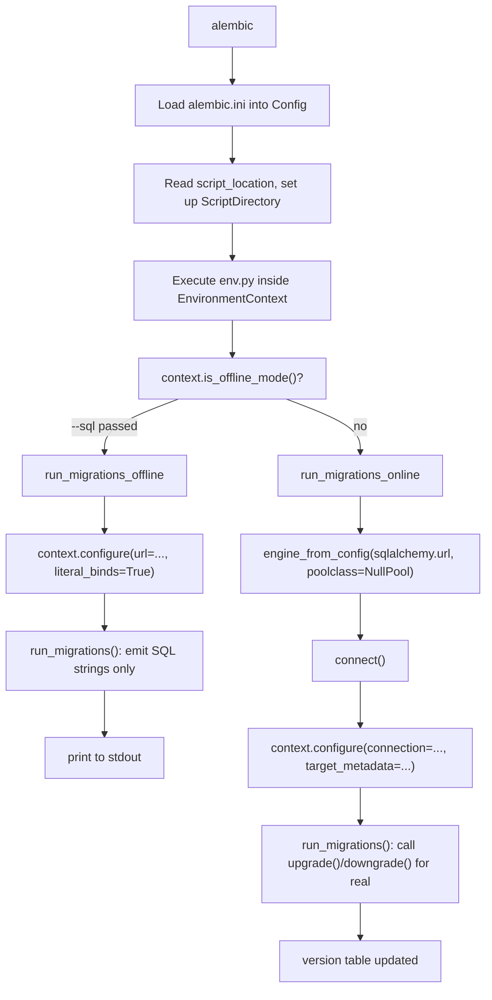

`poolclass=pool.NullPool` is deliberate: a migration process opens a connection,
runs, and exits. Connection pooling would only hold a connection open needlessly.

`compare_type=True` in both paths is what makes autogenerate notice column **type**
changes, not just added/removed columns and indexes.

### `alembic/script.py.mako`

The Mako template that generates new revision files. The repo's version defines
the four identity variables plus empty `upgrade()`/`downgrade()` stubs. Alembic
fills in `${upgrades}` / `${downgrades}` only when `--autogenerate` found something.

### `alembic/versions/`

The actual history. One file per schema change. **These files are permanent
history — never edit one after it has been applied to a shared database.**

---

## 4. How Alembic discovers your models

This is the single most misunderstood part, so it is worth being precise.

`--autogenerate` cannot scan your source tree for classes. It has no idea your
models are in `models/`. It only ever looks at `context.get_context()` metadata,
which is `target_metadata` from `env.py`.

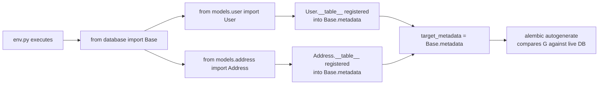

Two consequences follow:

1. **A model not imported in `env.py` is invisible to Alembic.** Add a new
   `models/invoice.py`, forget the import, run autogenerate, and you get an empty
   script with no error. Dropping the table entirely is the same failure mode.
2. **Models are collected by import side effects, not by discovery.** In SQLAlchemy
   2.0 declarative style, `Base` tracks every subclass that defines `__tablename__`
   in `Base.metadata.tables` at class-creation time.

The upstream fix is a `models/__init__.py` that imports everything, so a single
`from models import User, Address` in `env.py` pulls in the whole set. The current
two-line version works but must be extended by hand as models are added.

---

## 5. Autogenerate: how it works

`alembic revision --autogenerate` is a five-stage pipeline. Verified stages come
from `alembic/autogenerate/api.py` and the `compare/` package in the installed
wheel.

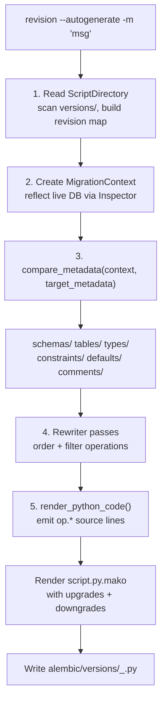

Stage 3 is the actual diff, split across six compare modules — visible in the log
when Alembic runs:

```text
INFO  [alembic.runtime.plugins] setting up autogenerate plugin alembic.autogenerate.schemas
INFO  [alembic.runtime.plugins] setting up autogenerate plugin alembic.autogenerate.tables
INFO  [alembic.runtime.plugins] setting up autogenerate plugin alembic.autogenerate.types
INFO  [alembic.runtime.plugins] setting up autogenerate plugin alembic.autogenerate.constraints
INFO  [alembic.runtime.plugins] setting up autogenerate plugin alembic.autogenerate.defaults
INFO  [alembic.runtime.plugins] setting up autogenerate plugin alembic.autogenerate.comments
```

The rewrite stage is why a single autogenerate run can produce a *tried-and-failed*
attempt before the real one: Alembic may emit `drop_column`, try it, get an error,
and convert it into a batch-mode `drop_column`. That reordering is invisible in the
output but visible in verbose logs.

### What the diff can actually detect

| Change | Detected? | Rendered as |
|---|:---:|---|
| New `Base` model / table | yes | `op.create_table(...)` |
| Removed model | yes | `op.drop_table(...)` |
| New column | yes | `op.add_column(...)` |
| Dropped column | yes | `op.drop_column(...)` |
| Index added/removed | yes | `op.create_index` / `op.drop_index` |
| Unique constraint | yes | `op.create_unique_constraint` / batch |
| FK constraint | yes | `op.create_foreign_key` / batch |
| Column type change | only with `compare_type=True` | `op.alter_column(type_=...)` |
| Nullable change | yes | `op.alter_column(nullable=...)` |
| `server_default` | yes | `op.alter_column(server_default=...)` |
| **Rename** a column | **no** | appears as drop + add, data lost |
| **Data** changes | **no** | nothing |
| Table/column **comments** | yes (needs `compare_comments`) | `create_table_comment` / `create_table_comment` for columns |
| CHECK constraints | limited | dialect-dependent |
| Renaming a table | **no** | drop + add |

The rename blind spot is the one that bites in practice. Alembic cannot know that
`drop_column('users', 'name')` + `add_column('users', 'full_name')` is a rename. It
reports the two operations literally. Renames must be hand-written as
`op.alter_column('users', 'name', new_column_name='full_name')`, then confirmed by
running autogenerate again and finding it clean.

---

## 6. Verified walkthrough in this repo

Run in a throwaway copy of the project (real `app.db` and `models/` untouched;
scratch directory deleted afterwards).

### Baseline

```console
$ alembic current
INFO  [alembic.runtime.migration] Context impl SQLiteImpl.
INFO  [alembic.runtime.migration] Will assume non-transactional DDL.
0001_initial (head)

$ alembic check
No new upgrade operations detected.
```

`alembic current` reads `alembic_version`; `alembic check` runs the autogenerate
diff and fails if anything is pending. That "no pending operations" result confirms
models and database are currently in sync — `0001_initial` genuinely matches
`models/user.py` and `models/address.py`.

Note the `Will assume non-transactional DDL` warning. SQLite cannot roll back DDL,
so if a migration fails halfway the database is left partially changed. The
consequences are in [§19](#19-failure-modes-and-fixes).

### Step 1 — change the model

Added to `models/user.py`:

```python
phone: Mapped[str] = mapped_column(String(20), nullable=True)
```

### Step 2 — autogenerate

```console
$ alembic revision --autogenerate -m "add phone to users"
INFO  [alembic.autogenerate.compare.tables] Detected added column 'users.phone'
INFO  [alembic.runtime.migration] Generating ...\7c46a8bf46c8_add_phone_to_users.py ... done
```

Generated file, verbatim:

```python
"""add phone to users

Revision ID: 7c46a8bf46c8
Revises: 0001_initial
Create Date: 2026-10-09 12:44:11.380497
"""
revision: str = '7c46a8bf46c8'
down_revision: Union[str, Sequence[str], None] = '0001_initial'
branch_labels: Union[str, Sequence[str], None] = None
depends_on: Union[str, Sequence[str], None] = None

def upgrade() -> None:
    # ### commands auto generated by Alembic - please adjust! ###
    op.add_column('users', sa.Column('phone', sa.String(length=20), nullable=True))
    # ### end Alembic commands ###

def downgrade() -> None:
    op.drop_column('users', 'phone')
```

Points worth noting:

- **The revision id is `uuid.uuid4().hex[-12:]`** (12 hex chars) — see
  `alembic/util/langhelpers.py:rev_id`. It is random, so two developers on two
  branches get different ids for the same logical change. That is why
  `0001_initial` here looks so different: it was made by hand, or with
  `--rev-id`. Pass `--rev-id` for readable sequential ids.
- `down_revision` was auto-filled with `0001_initial`, because that is the current
  head. You never write this by hand.
- The auto-generated block is delimited by `# ### commands auto generated by
  Alembic - please adjust! ###` comments. **Write your own code outside those
  markers** so a future autogenerate does not clobber it.
- The generated `op.drop_column` on SQLite is wrong in practice — see §14.

### Step 3 — apply

```console
$ alembic upgrade head
INFO  [alembic.runtime.migration] Running upgrade 0001_initial -> 7c46a8bf46c8, add phone to users
```

Verified directly in SQLite:

```text
version: 7c46a8bf46c8
users columns: ['id', 'name', 'email', 'is_active', 'phone']
```

`alembic_version` moved to the new revision and the column exists. Alembic updates
the version table **per revision**, inside the same transaction as that revision's
statements (where the database supports transactional DDL).

### Step 4 — reverse

```console
$ alembic downgrade -1
INFO  [alembic.runtime.migration] Running downgrade 7c46a8bf46c8 -> 0001_initial, add phone to users
```

```text
version: ['0001_initial']
users columns: ['id', 'name', 'email', 'is_active']
```

Round trip complete. `down_revision` is what makes this possible.

### Full lifecycle, verified

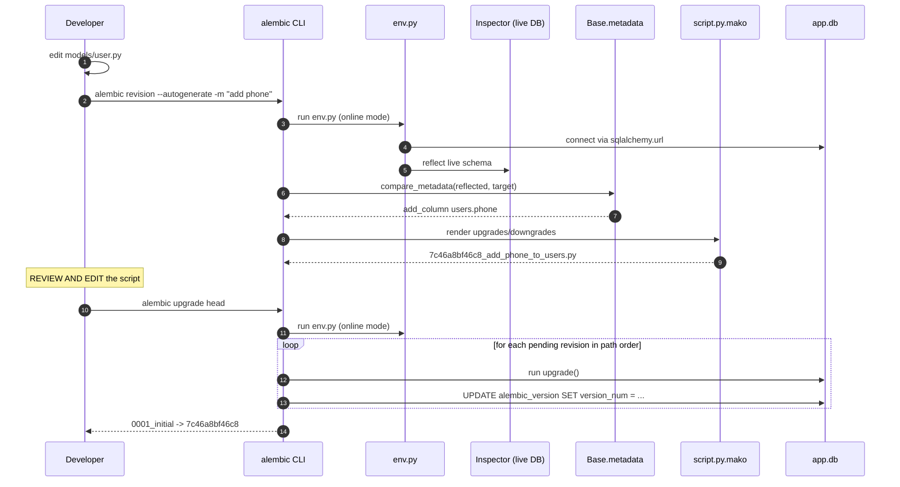

---

## 7. Autogenerate limitations

Autogenerate produces a **first draft**, never a finished migration. Treat it as a
diff report you then edit. Specific gaps:

**Not detected:**
- Column and table **renames** (data loss risk — see §5)
- Any data transformation. `UPDATE users SET is_active = 1` has no schema diff.
- Ordering-sensitive changes. Autogenerate emits `drop_column` then `add_column`
  for a rename; on some backends that ordering loses data.
- Changes made to the database by hand. Alembic diffs *models vs database*, never
  *migrations vs database*. If someone ran raw DDL, autogenerate is blind to it.
- SQLite `ALTER TABLE` limitations — the DB genuinely cannot express many changes
  without rebuilding the table.

**Detected but often rendered wrong:**
- Dropped columns on SQLite: plain `op.drop_column` works on modern SQLite via the
  `ALTER TABLE ... DROP COLUMN` path but fails if the column is indexed or
  referenced. Alembic's rewrite pass often converts it to `batch_alter_table`,
  which rebuilds the table.
- NOT NULL additions without a default (see §19).
- Table rebuilds on SQLite generate a large diff of unchanged columns unless batch
  mode is used correctly.

**Always review the generated file.** The `# please adjust!` comment is literal
advice, not boilerplate.

---

## 8. The `alembic_version` table

Alembic creates this table itself on first run. In this project, verbatim:

```sql
CREATE TABLE alembic_version (
    version_num VARCHAR(32) NOT NULL,
    CONSTRAINT alembic_version_pkc PRIMARY KEY (version_num)
)
```

Current contents: one row, `('0001_initial',)`.

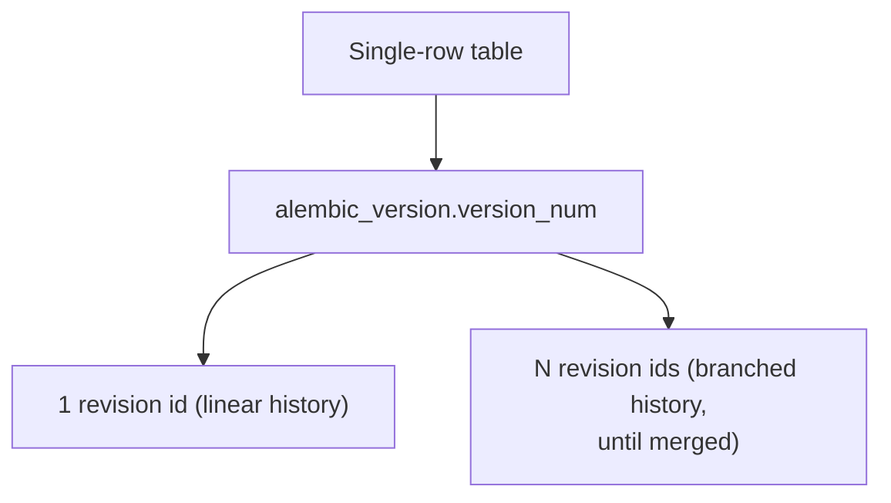

Semantics:

- **The row count equals the number of active heads.** One head, one row. Two heads
  (unmerged branches), two rows — Alembic warns about multiple heads and requires
  `merge`.
- **Stored value length is capped at 32 characters** (`VARCHAR(32)`). That is why
  generated ids are 12 hex chars and hand-written ones like `0001_initial` are kept
  short. A longer `--rev-id` will truncate or error.
- **Never hand-edit it** except via `alembic stamp`.
- **`NULL` is a valid state**: a version table with no row means "an unversioned
  database with tables already present". `upgrade head` from `None` runs *every*
  revision, including `create_table` for tables that already exist → error. `stamp
  head` is the correct tool there.

---

## 9. Upgrade and downgrade internals

`alembic/runtime/migration.py` holds the executor.

### How a path is computed

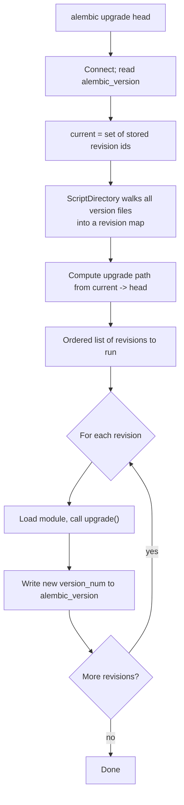

Target forms accepted by `--rev-id`/`upgrade`:

| Target | Meaning |
|---|---|
| `head` | newest on the (single) branch |
| `base` | before everything |
| `0001_initial` | that exact revision |
| `0001_initial:0002_add_phone` | a **range**, inclusive of the end |
| `heads` | all current heads |
| `<branchname>@head` | head of a named branch |

### Transaction semantics

```text
if dialect supports transactional DDL:
    one transaction wraps the whole run (PostgreSQL, most others)
    failure -> nothing applied
else:
    Alembic logs "Will assume non-transactional DDL"
    each revision commits as it completes
    failure -> database left at the last completed revision
```

SQLite falls in the second category, which is what this project hits. It is why
"Will assume non-transactional DDL" appears on every command, and why a failed
migration can leave `alembic_version` pointing at a revision whose statements were
only half applied.

### Per-revision version update

For each step Alembic does, in order:

1. Run `upgrade()` (or `downgrade()`).
2. Update `alembic_version` to the new revision.
3. Commit.

So `alembic_version` is a reliable record of *completed* steps only.

---

## 10. Offline (SQL) mode

`--sql` emits the SQL statements instead of executing them. Verified output for
this project's `0001_initial`:

```console
$ alembic upgrade head --sql
INFO  [alembic.runtime.migration] Generating static SQL

CREATE TABLE alembic_version (
    version_num VARCHAR(32) NOT NULL,
    CONSTRAINT alembic_version_pkc PRIMARY KEY (version_num)
);

-- Running upgrade  -> 0001_initial

CREATE TABLE users (
    id INTEGER NOT NULL,
    name VARCHAR(50) NOT NULL,
    email VARCHAR(100) NOT NULL,
    is_active BOOLEAN NOT NULL,
    PRIMARY KEY (id)
);

CREATE UNIQUE INDEX ix_users_email ON users (email);
CREATE INDEX ix_users_id ON users (id);

CREATE TABLE addresses (...);
```

How it works: `env.py` takes the `run_migrations_offline()` branch, calls
`context.configure(url=..., literal_binds=True, dialect_opts={"paramstyle":
"named"})`, and Alembic renders each operation to a string. **No connection is
opened**, so it works without DB credentials.

Two important constraints:

- `literal_binds=True` means values are inlined as literals rather than bound
  parameters. Required, since there is no cursor to bind to.
- **Autogenerate cannot work offline.** Diffing requires reflecting the live
  database. `--autogenerate` with `--sql` is not a supported combination; it needs
  a connection.

Typical uses: handing a DBA a reviewed `.sql` file, applying the same migration to
many databases, or auditing what a revision will do before you run it.

---

## 11. Branching, merging, and `depends_on`

### Linear history (this project, and what you want)

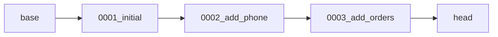

Every `down_revision` is a single id or `None`. `alembic heads` reports one head.

### Branched history

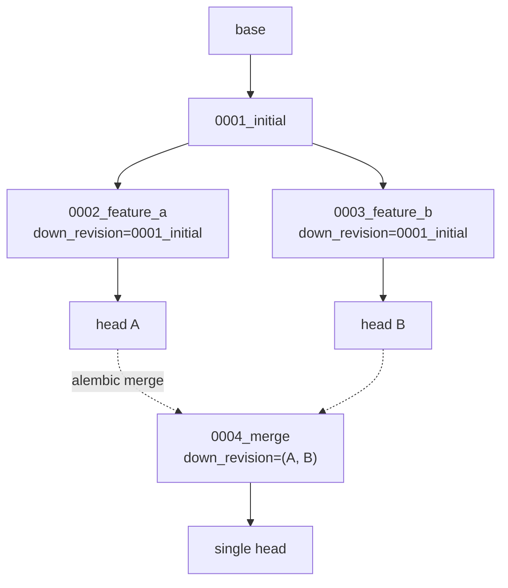

`down_revision` becomes a **tuple** on the merge revision. Two heads mean two rows
in `alembic_version`.

Why you should avoid this in a small project: every merge revision is permanent
history, merges are easy to get wrong, and multiple rows in `alembic_version`
complicate debugging and dumps. Branch only when you must support two release lines.

### `branch_labels` and `depends_on`

| Field | Purpose |
|---|---|
| `down_revision` | **Lineage.** True parent. Determines upgrade/downgrade ordering. |
| `depends_on` | **Ordering only.** A dependency is executed first but is *not* considered an ancestor. Used for cross-branch ordering. |
| `branch_labels` | Names a branch so you can target `<label>@head`. Does not affect execution. |

The distinction matters: `depends_on` creates an ordering constraint without
claiming ancestry, so a `downgrade` will not touch the depended-on revision.
Creating one: `alembic revision --depends-on 0002_add_phone -m "..."`.

---

## 12. `stamp` vs `upgrade`

Both move `alembic_version`. Only one changes the schema.

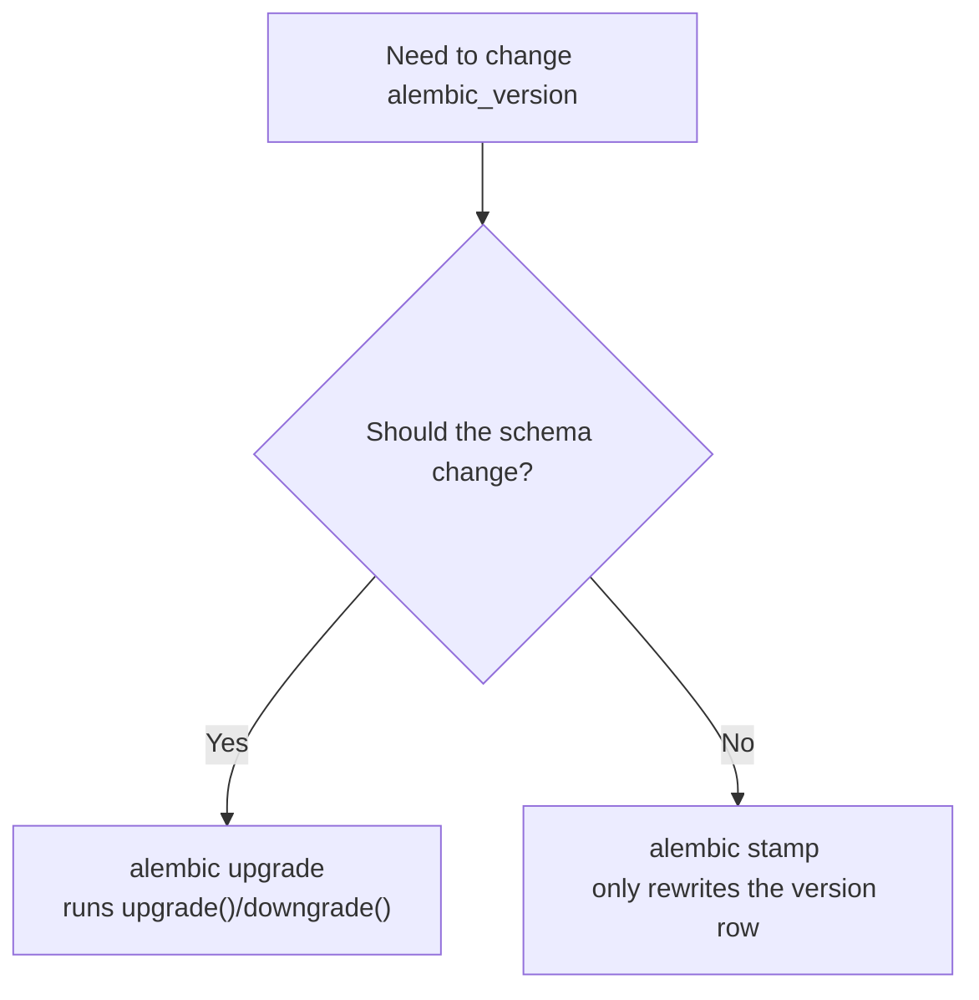

`stamp` is for:

- **Adopting Alembic on an existing populated database.** Write an empty baseline
  revision, then `alembic stamp head` so Alembic believes it is current, without
  touching existing data.
- **Resetting a local dev database** after destroying and recreating it:
  `alembic stamp head` — or if the DB is empty, `alembic upgrade head` is fine.
- **Marking a migration as manually applied** after you ran its SQL by hand.

Conversely, `alembic stamp base` on a populated database makes Alembic think it
must create every table again — the next `upgrade` fails with "table already
exists".

**Never `stamp` in a deploy pipeline.** Deployment should always `upgrade`, so the
migration actually runs and the version table is not lying.

---

## 13. `op` — the operation catalogue

`alembic.op` is the module-level façade to whatever migration is currently running.
Every operation is available as `op.<name>()`. From the installed `op.pyi`:

| Operation | Purpose |
|---|---|
| `op.create_table(name, *columns, **kw)` | create a table |
| `op.drop_table(name)` | drop a table |
| `op.rename_table(old, new)` | rename a table |
| `op.add_column(tbl, col, **kw)` | add a column |
| `op.drop_column(tbl, name, **kw)` | drop a column |
| `op.alter_column(tbl, name, **kw)` | type/nullability/default/rename |
| `op.create_index(name, tbl, cols, **kw)` | create an index |
| `op.drop_index(name, **kw)` | drop an index |
| `op.create_unique_constraint` / `op.drop_constraint` | constraints |
| `op.create_foreign_key` / `op.create_primary_key` / `op.create_check_constraint` | keys and checks |
| `op.batch_alter_table(name, **kw)` | context manager for batch mode |
| `op.execute(sql_or_clause)` | run arbitrary SQL |
| `op.bulk_insert(table, rows)` | batch INSERT from a migration |
| `op.get_bind()` | raw `Connection` for ORM use |
| `op.get_context()` | the `MigrationContext` |
| `op.f(name)` | mark a name as a "function" for autogenerate |
| `op.invoke(op_obj)` | invoke an operation object directly |
| `op.register_operation(...)` | plug in custom operations |

`op.alter_column` keyword arguments worth knowing:

```python
op.alter_column("users", "email",
    type_=sa.String(200),          # type change
    nullable=False,                # NOT NULL
    server_default=sa.text("''"),  # default
    new_column_name="email_address",  # RENAME - never autogenerated
)
```

### `alembic.operations` — building migrations in Python

For conditional or programmatic migrations, `Operations` and `MigrationContext`
can be driven directly instead of writing `op.*` by hand:

```python
from alembic.operations import Operations
from alembic.runtime.migration import MigrationContext

conn = op.get_bind()
ctx = MigrationContext.configure(conn)
ops = Operations(ctx)
ops.add_column("users", sa.Column("phone", sa.String(20), nullable=True))
```

This is how tooling wraps a `MigrationContext` for third-party migration libraries.

---

## 14. Batch operations and SQLite

SQLite's `ALTER TABLE` is famously limited. It cannot drop a column that is indexed
or referenced, cannot alter a column's type, and cannot drop a constraint. The
original workaround is to rebuild the table:

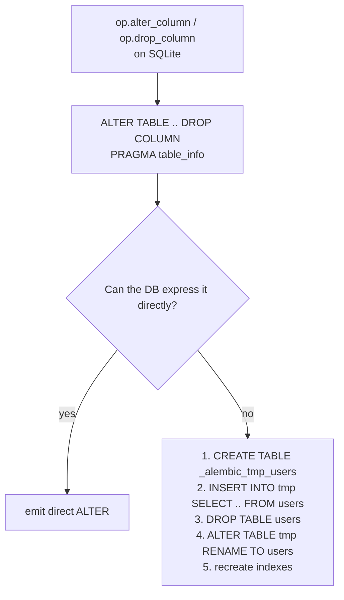

`op.batch_alter_table()` automates exactly this. Used in the verified walkthrough:

```python
def upgrade() -> None:
    with op.batch_alter_table('users') as batch_op:
        batch_op.add_column(sa.Column('phone', sa.String(length=20), nullable=False))

def downgrade() -> None:
    with op.batch_alter_table('users') as batch_op:
        batch_op.drop_column('phone')
```

`recreate` controls the strategy (`alembic/operations/batch.py` validates it against
`"auto"`, `"always"`, `"never"`):

| Value | Behaviour |
|---|---|
| `"auto"` (default) | rebuild only when the DB cannot express the change natively |
| `"always"` | always rebuild — predictable, but expensive on large tables |
| `"never"` | never rebuild; emit direct DDL and let it fail if unsupported |

Batch mode has real costs. It **copies all data**, takes an exclusive lock for the
duration, and does not preserve things SQLAlchemy cannot reflect — triggers, some
views, and SQLite-specific pragmas. `copy_from` lets you control the data copy
manually. `naming_convention` is often needed to make constraint names stable across
rebuilds, since constraint names are otherwise regenerated.

**The practical takeaway for this project:** the autogenerated
`op.drop_column('users', 'phone')` will fail on SQLite if `phone` is ever indexed or
referenced. Wrap structural column changes in `batch_alter_table` from the start.

---

## 15. Data migrations

Alembic is not limited to DDL. Any Python works inside `upgrade()`.

### Raw SQL

```python
def upgrade() -> None:
    op.execute("UPDATE users SET is_active = 1 WHERE is_active IS NULL")
    op.execute("DELETE FROM users WHERE email LIKE '%@deleted.example'")
```

### The ORM, via `op.get_bind()`

```python
import sqlalchemy as sa

def upgrade() -> None:
    conn = op.get_bind()
    users = sa.table("users",
        sa.column("id", sa.Integer),
        sa.column("is_active", sa.Boolean),
    )
    conn.execute(users.update().values(is_active=True))

def downgrade() -> None:
    # Irreversible. Say so explicitly.
    raise NotImplementedError("data backfill is not reversible")
```

### `bulk_insert` for seeding

```python
def upgrade() -> None:
    users = sa.table("users",
        sa.column("name", sa.String),
        sa.column("email", sa.String),
        sa.column("is_active", sa.Boolean),
    )
    op.bulk_insert(users, [
        {"name": "Admin",  "email": "admin@example.com",  "is_active": True},
        {"name": "Reader", "email": "reader@example.com", "is_active": True},
    ])
```

`bulk_insert` is a `Core` bulk operation — it bypasses ORM events and identity
map, which is why it works on millions of rows.

### Rules for data migrations

1. **Batch large updates.** One `UPDATE` over millions of rows holds locks for a long
   time. Chunk it in a loop with explicit `LIMIT`/`OFFSET` or a keyset on `id`.
2. **Decide reversibility honestly.** A dropped column's data cannot be restored.
   `raise NotImplementedError` beats a `downgrade()` that silently lies.
3. **Keep migrations fast and safe to re-run.** Deploys run more than once, and a
   retry after a partial failure will re-run from the last recorded revision.
4. **Separate schema and data when they have different risk profiles.** Big backfills
   deserve their own revision so they can be deferred.

---

## 16. Async migrations

If the app uses `asyncpg`/`psycopg` async engines, `run_sync()` bridges async into
Alembic's synchronous API:

```python
import asyncio
from alembic import context

def do_run_migrations(connection):
    context.configure(connection=connection, target_metadata=Base.metadata)
    with context.begin_transaction():
        context.run_migrations()

async def run_async_migrations():
    connectable = async_engine.connect()
    await connectable.run_sync(do_run_migrations)
    await connectable.close()

def run_migrations_online():
    asyncio.run(run_async_migrations())
```

Alembic ships templates for this: `alembic init --template async` (and
`pyproject_async`). This repo uses the **online synchronous** template because
`database.py` builds a plain sync `create_engine`.

---

## 17. Operational cheat sheet

Every command below is from `alembic --help` in this environment (v1.20.0).

| Command | What it does |
|---|---|
| `alembic init <dir>` | scaffold a migration environment (templates: `generic`, `async`, `pyproject`, `pyproject_async`, `multidb`) |
| `alembic list_templates` | show available init templates |
| `alembic revision -m "msg"` | create an empty revision at head |
| `alembic revision --autogenerate -m "msg"` | create a revision populated from the model-vs-DB diff |
| `alembic upgrade <target>` | run `upgrade()` up to `<target>`; `--sql` for offline |
| `alembic downgrade <target>` | run `downgrade()` back to `<target>`; `-1` = one step |
| `alembic current` | show the revision(s) the database is at |
| `alembic heads` | show heads available in the versions directory |
| `alembic history` | full revision graph; `--verbose` adds docstrings and paths |
| `alembic show <rev>` | show a specific revision |
| `alembic branches` | show branch points |
| `alembic merge <revs>` | create a merge revision |
| `alembic stamp <target>` | set the version row without running migrations |
| `alembic check` | fail if autogenerate has pending ops (CI gate) |
| `alembic ensure_version` | create `alembic_version` if missing |
| `alembic edit` | open revisions in `$EDITOR` |

Global flags: `-c/--config` (alternate config, may be `pyproject.toml`),
`-n/--name` (ini section name), `-x k=v` (passed to custom `env.py`),
`--raiseerr` (full traceback), `-q/--quiet`.

`--rev-id`, `--head`, `--splice`, `--branch-label`, `--depends-on`,
`--version-path` are `revision`-specific.

### Workflow for this repo

```powershell
# 1. edit models/user.py
# 2. draft the migration
uv run alembic revision --autogenerate -m "add phone to users"
# 3. READ the generated file; fix ordering, nullability, batch mode, data steps
# 4. apply locally
uv run alembic upgrade head
# 5. confirm the diff is now clean
uv run alembic check
# 6. commit model change AND migration in one commit
```

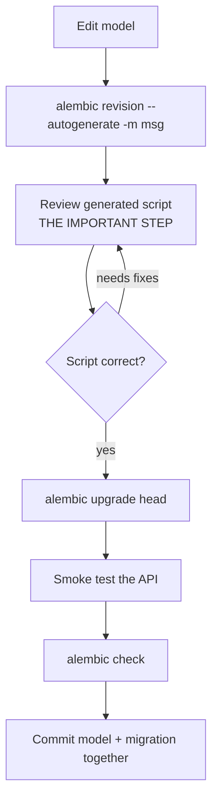

---

## 18. Recommended practices

1. **Never call `Base.metadata.create_all()` in a real app.** It cannot alter
   anything and it makes Alembic's version table meaningless. This project is
   already correct here — `database.py` only builds the engine.
2. **Migrations ship with the model change, in the same commit.** A model column
   with no migration breaks every other environment.
3. **One logical change per revision.** Mixed revisions are impossible to review,
   cherry-pick, or roll back.
4. **Always review the autogenerated diff.** Especially renames, dropped columns,
   and anything autogenerated on SQLite.
5. **Always write a real `downgrade()`.** `pass` in a downgrade you might need is a
   future outage. If truly irreversible, raise instead of pretending.
6. **Use `op.get_bind()` for data steps, not a second engine.** Never create your own
   connection inside a migration; you lose transaction control.
7. **Use batch mode on SQLite** for column drops, type changes, and constraint drops.
8. **Test both directions.** `upgrade head` then `downgrade base` on a scratch
   database, for every migration, in CI.
9. **Run `alembic check` in CI.** It fails the build if models and migrations drift
   apart.
10. **Keep `alembic.ini`'s `sqlalchemy.url` and `database.py` in lockstep.** Better:
    have `env.py` reuse the app's engine (see §20).
11. **No destructive changes in the same release as code that depends on the old
    shape.** Expand/contract: release N adds the new column and writes both, release
    N+1 reads only the new one, release N+2 drops the old.
12. **Never edit an applied revision.** Add a new one. History is append-only.

---

## 19. Failure modes and fixes

### `no such table: users`

The database has no tables. `database.py` creates the engine but never calls
`create_all()`, and `alembic upgrade head` was never run.

```powershell
uv run alembic upgrade head
```

### `Table 'users' already exists`

`alembic_version` says `base` but tables exist — typically after `alembic stamp base`
or after restoring a dump. Alembic tries to re-create.

```powershell
uv run alembic stamp head   # table already matches; just record it
```

### `Cannot add a NOT NULL column with default value NULL`

Reproduced verbatim during the walkthrough above. Adding
`sa.Column('phone', sa.String(20), nullable=False)` to a table with existing rows
fails:

```text
sqlite3.OperationalError: Cannot add a NOT NULL column with default value NULL
```

SQLite cannot satisfy the constraint for rows already present. Fixes, in order of
preference:

```python
# 1. Add with a server_default first, then drop the default in a later migration
op.add_column('users', sa.Column('phone', sa.String(20),
                                 nullable=False, server_default=''))

# 2. Three-step: add nullable, backfill, then tighten
op.add_column('users', sa.Column('phone', sa.String(20), nullable=True))
op.execute("UPDATE users SET phone = '' WHERE phone IS NULL")
op.alter_column('users', 'phone', nullable=False, existing_type=sa.String(20))
```

Option 2 needs `batch_alter_table` on SQLite, because `ALTER COLUMN` is not
supported there.

### `Cannot add a NOT NULL column ...` after a partial failure

Non-transactional DDL left the DB half-migrated. Check actual state before retrying:

```powershell
uv run alembic current
# inspect the real columns, then either
uv run alembic stamp <rev>   # if the DDL actually landed
uv run alembic downgrade -1  # if it did not
```

Always inspect. Guessing here can silently corrupt data.

### `Multiple head revisions are present`

Branches were created and not merged.

```powershell
uv run alembic heads                 # see them
uv run alembic merge -m "merge heads" <rev1> <rev2>
uv run alembic upgrade head
```

### Autogenerate produces an empty script

Almost always an unimported model in `env.py`. Confirm every model module is
imported there (see §4). Then `alembic check` should also report no pending ops
while the database lacks the table — a useful cross-check.

### Autogenerate generates a drop + add where a rename was intended

Expected. Replace it by hand with
`op.alter_column('users', 'name', new_column_name='full_name')` inside a
`batch_alter_table` block on SQLite, then re-run `alembic check`.

### `Target database is not up to date`

You asked to `downgrade` past the current revision, or `upgrade` to a target on a
different branch. Read `alembic current` and `alembic history` first.

### SQLAlchemy errors appear as Alembic errors

Alembic wraps underlying DBAPI exceptions; the root cause is in the chained
traceback. Run with `--raiseerr` to see the full chain.

---

## 20. How this project should evolve

Ordered by value. Each item names the file it touches.

1. **Single source of truth for the DB URL.** `alembic.ini` and `database.py` both
   hardcode `sqlite:///./app.db`. Have `env.py` import the app's engine instead:
   ```python
   from database import engine
   with engine.connect() as connection:
       context.configure(connection=connection, target_metadata=Base.metadata,
                         compare_type=True)
       with context.begin_transaction():
           context.run_migrations()
   ```
   Then `sqlalchemy.url` becomes irrelevant and the two can never drift.

2. **`models/__init__.py` re-exporting every model**, then `env.py` imports from
   the package. Removes the "forgot to import the new model" failure mode.

3. **Switch migrations to `op.get_bind()`** so they share the app's engine and
   transaction handling.

4. **Enable CI on `alembic check`.** Cheap, and it is the single best guard against
   schema/code drift.

5. **Adopt readable revision ids** via `--rev-id` (e.g. `0002_add_user_phone`)
   instead of 12-char random hex. Note the 32-character `version_num` limit.

6. **Add a batch-mode convention.** Document in `alembic/README` that structural
   column changes on SQLite go through `op.batch_alter_table`.

7. **Plan the PostgreSQL move.** Only `sqlalchemy.url`, the driver, and a review of
   `env.py` change. Migrations themselves are mostly portable, except any batch-mode
   or SQLite-specific steps written as above. Test the `downgrade` path on the target
   backend before deploying.

---

## Appendix — quick reference card

```text
Mental model
  Model code --(autogenerate diff)--> revision script --(upgrade)--> DB
  Base.metadata vs reflected DB          executed, recorded in alembic_version

Identity        revision = id, down_revision = parent (None at root)
Position        head / base / <rev> / <start>:<end>, NOT numbers
Bookkeeping     alembic_version.version_num, 1 row per head, max 32 chars
Autogenerate    detects schema only; blind to renames and all data changes
Imports         env.py imports every model, else autogenerate sees nothing
SQLite          non-transactional DDL; use op.batch_alter_table for column ops
stamp           record a version, do NOT change the schema
check           CI gate: fail if models and DB have drifted

Commands
  alembic revision --autogenerate -m "msg"
  alembic upgrade head | <rev> | base | head:<rev>
  alembic downgrade -1 | <rev> | base
  alembic current | heads | history | branches | show <rev>
  alembic stamp <rev> | check | merge -m "msg" <a> <b>
  alembic upgrade head --sql        (offline, no DB connection)

Workflow
  edit model -> revision --autogenerate -> REVIEW SCRIPT -> upgrade head -> check -> commit
```

Related documents in this repo:

- `README.md` — project stack and request flow
- `ARCHITECTURE_FLOW.md` — layer-by-layer reference
- `alembic/README` — the two commands you actually need day to day