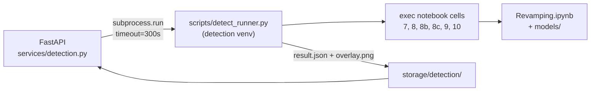

# DETECTION.md — Cargo Detection (SAM + YOLO) in FastAPI

How `awesome-project` runs the computer-vision pipeline documented in
`Working.md`, and what it deliberately does not do.

---

## Contents

1. [What this integration does](#1-what-this-integration-does)
2. [Why a subprocess, not an import](#2-why-a-subprocess-not-an-import)
3. [Architecture](#3-architecture)
4. [How the notebook is executed](#4-how-the-notebook-is-executed)
5. [Configuration](#5-configuration)
6. [Endpoints](#6-endpoints)
7. [Response semantics — the part that matters](#7-response-semantics--the-part-that-matters)
8. [What the numbers mean](#8-what-the-numbers-mean)
9. [Storage](#9-storage)
10. [Testing](#10-testing)
11. [Verified behaviour](#11-verified-behaviour)
12. [Known limitations](#12-known-limitations)

---

## 1. What this integration does

A signed-in user uploads a cargo image through the portal, then asks the API to
run detection on it. The API returns **what was in the picture**: how many cargo
regions, where each one is in pixels, how confident the detector and the
segmenter were, and an annotated overlay showing the segmented cargo.

It does **not** return a weight in kilograms. See
[§8](#8-what-the-numbers-mean) — that is a deliberate refusal, not a missing
feature.

---

## 2. Why a subprocess, not an import

The detector cannot be imported into this application. The two environments
cannot be merged:

| | `awesome-project/.venv` | detection `.venv` |
|---|---|---|
| FastAPI, SQLAlchemy, psycopg | ✅ | — |
| torch 2.10 + cu128 | ❌ | ✅ (~2 GB) |
| ultralytics, segment-anything | ❌ | ✅ |
| transformers, Open3D, OpenCV | ❌ | ✅ |
| total | ~120 MB | **~5.5 GB** |

Importing the detector here would add 5.5 GB to a service that needs none of it,
and the two `torch` builds would have to agree on CUDA versions. So the two
sides meet at a **file**:



`scripts/detect_runner.py` lives in **this** repository and is executed **by the
other project's interpreter**. The integration code is version-controlled
alongside the API; the models are not duplicated.

---

## 3. Architecture

| File | Role |
|---|---|
| `scripts/detect_runner.py` | Executes the notebook cells, writes `result.json` + `overlay.png` |
| `services/detection.py` | The subprocess bridge: availability, timeout, concurrency, parsing |
| `routers/detection.py` | Portal HTTP surface |
| `routers/admin.py` | Admin read-only surface |
| `schemas/responses/detection.py` | Response shapes |
| `models/inspection.py` | `detection_result`, `detected_at`, `detection_overlay` |
| `alembic/versions/0011_detection_results.py` | The three columns |
| `tests/test_detection.py` | 50 tests |

---

## 4. How the notebook is executed

This is the part that needs explaining, because the pipeline is a **notebook**,
not a library.

### The cells are not modules

`Revamping.ipynb` has 31 cells that share one global namespace. Cell 22 calls
`cargo_stage()`, defined ten cells earlier; cell 26 reads six names from cells
before it:

```python
# colab_cells/cell22_volume.py
with cargo_stage("22. 3D volume", total=len(point_clouds), unit="image"):

# colab_cells/cell26_result.py
"volume": float(volumes[0]),  "density": density,  "cargo_type": cargo_type,
```

`import cell22_volume` would raise `NameError`. They must be executed, **in
order, into one `dict`**:

```python
namespace = {"__name__": "__main__"}
for cell in ("CELL 2", "CELL 4", "CELL 7", "CELL 8", "CELL 8b", "CELL 8c",
             "CELL 9", "CELL 10"):
    exec(compile(strip_magics(source[cell]), f"<{cell}>", "exec"), namespace)
```

This is exactly what `_build/_e2e_test.py` already does successfully, so the
approach is proven rather than invented.

### Three adaptations

**1. The tkinter dialog is skipped.** Cell 3 opens a GUI file picker, which has
no place in a server process. `image_paths` is assigned directly instead:

```python
namespace["image_paths"] = [str(image)]
```

**2. `OUTPUT_DIR` is redirected per run.** The notebook hardcodes `outputs/`, so
two concurrent requests would overwrite each other's overlays. One assignment
after cell 2 relocates everything the run produces:

```python
namespace["OUTPUT_DIR"] = out_dir / "outputs"
```

**3. Cells 12–28 are not run.** Those do depth, point cloud and volume. See
[§8](#8-what-the-numbers-mean).

### The result is parsed from the log

Cell 10 prints its verdict rather than returning it:

```text
Image 1: accepted 'Cargo-Box' (score 16.3, box 10% of frame, border leak 0%) x2 object(s).
  Cargo #1: class=Cargo-Box yolo=0.83 sam=0.93 mask_area=17051px tight=[52, 287, 196, 459]
```

So `detect_runner.py` regexes those lines out. That is deliberate: recomputing
the tight box here would mean a **second implementation** of the ROI→full-image
coordinate maths, free to drift from the notebook. Reading the notebook's own
answer cannot.

---

## 5. Configuration

Everything lives in `.env`, off by default:

```ini
DETECTION_ENABLED = true
DETECTION_PYTHON = C:\Users\Abhijeet\Desktop\AI-Driven Cargo Detection\.venv\Scripts\python.exe
DETECTION_PROJECT_DIR = C:\Users\Abhijeet\Desktop\AI-Driven Cargo Detection
DETECTION_TIMEOUT = 300
DETECTION_MAX_CONCURRENCY = 1
```

Check it without starting the server:

```powershell
.venv\Scripts\python.exe -m services.detection
```

```text
available: True
ready
```

It names exactly what is missing when it is not — an unreadable path is far more
useful than a 503 at the first upload.

### Why `DETECTION_MAX_CONCURRENCY` must stay 1

The notebook's cells share module-level state and write into one project
directory. Two overlapping runs would interleave into the same files. A
non-blocking semaphore refuses the second request with **503** rather than
letting it corrupt the first.

---

## 6. Endpoints

| Method | Path | Who | Purpose |
|---|---|---|---|
| `GET` | `/portal/detection/availability` | user | Can the detector run? Why not? |
| `POST` | `/portal/submissions/{id}/detect` | owner | **Run** detection (blocks 16–45 s) |
| `GET` | `/portal/submissions/{id}/detection` | owner | Last stored result |
| `GET` | `/portal/submissions/{id}/detection/log` | owner | stdout tail, for a failed run |
| `GET` | `/portal/submissions/{id}/detection/overlay` | owner | Annotated PNG |
| `GET` | `/admin/submissions/{id}/detection` | admin | Any result (read-only) |
| `GET` | `/admin/submissions/{id}/detection/overlay` | admin | Any overlay |

### Example

```powershell
# 1. is it available?
Invoke-RestMethod http://127.0.0.1:8000/portal/detection/availability -WebSession $s

# 2. run it (this blocks ~30 s)
Invoke-RestMethod -Method Post `
  http://127.0.0.1:8000/portal/submissions/16/detect -WebSession $s

# 3. read it back, any time
Invoke-RestMethod http://127.0.0.1:8000/portal/submissions/16/detection -WebSession $s
```

```json
{
  "ok": true, "detected": true, "status": "detected",
  "label": "Cargo-Box", "score": 16.3, "object_count": 2,
  "objects": [
    { "label": "Cargo-Box", "yolo_confidence": 0.83, "sam_score": 0.93,
      "box_px": [52.0, 287.0, 196.0, 459.0], "mask_area_px": 17051 },
    { "label": "Cargo-Box", "yolo_confidence": 0.44, "sam_score": 0.94,
      "box_px": [260.0, 215.0, 444.0, 439.0], "mask_area_px": 29188 }
  ],
  "box_fraction_of_frame": 0.1, "mask_area_ratio": 0.0682, "border_leak": 0.0,
  "detector_origin": "zip_trained_obb", "uses_zip_taxonomy": true,
  "elapsed_seconds": 25.77, "has_overlay": true,
  "overlay_url": "/portal/submissions/16/detection/overlay"
}
```

### Caching

A second `POST` returns the stored result instantly instead of spending another
30 s. Pass `?force=true` to re-run — needed after the weights or the notebook
change:

```powershell
Invoke-RestMethod -Method Post "http://127.0.0.1:8000/portal/submissions/16/detect?force=true" -WebSession $s
```

---

## 7. Response semantics — the part that matters

Three outcomes that look similar in code are genuinely different, and
conflating them makes the API misleading:

| Situation | HTTP | `ok` | `detected` | `status` |
|---|---|:--:|:--:|---|
| Cargo found | **200** | `true` | `true` | `detected` |
| Ran, found nothing | **200** | `true` | `false` | `no_cargo` |
| Detector broken | **502** | `false` | `false` | `error` |
| Disabled / misconfigured | **503** | — | — | — |
| Another user's submission | **404** | — | — | — |
| Exceeded the timeout | **504** | — | — | — |
| Never run | **200** | `false` | `false` | `not_run` |

**A refusal is a success.** An image with no cargo returns 200. "Nothing there"
is a correct answer to the question asked, and forcing the caller to read a
503 as "no cargo found" would be a lie in the other direction.

**`not_run` and `no_cargo` are different facts.** `not_run` means nobody has
tried; `no_cargo` means the pipeline looked and found nothing. `status` is
derived from `detection_result` rather than stored, so it cannot drift.

**A broken detector never returns 200.** A 200 would tell the caller the
detection worked. It did not. The failure *is* still stored, so it can be
inspected.

### Ownership

Another user's submission returns **404, not 403** — a 403 would confirm the id
exists, letting anyone walk the id space to enumerate submissions. This matches
the rule used everywhere else in the app.

---

## 8. What the numbers mean

### Honest about the geometry

| Field | Meaning |
|---|---|
| `box_px` | `[x1, y1, x2, y2]`, **full-image pixels** — no ROI translation needed |
| `box_fraction_of_frame` | Bounding box as a 0–1 share. Cell 10 rejects > 0.60 |
| `mask_area_ratio` | Segmented cargo as a 0–1 share. Smaller than the box share |
| `border_leak` | Share of the 3 px frame border covered by the mask. Rejected > 0.12 |
| `score` | Cell 10's selection score. **The acceptance threshold is 6.0** |
| `yolo_confidence` | Detector confidence for that object |
| `sam_score` | Segmenter's quality score — segmentation, not detection |

`border_leak` is a genuinely useful signal: sky and water masks glue to the frame
edge, suspended cargo does not.

### Why there is no weight in kilograms

The pipeline's measurement stage (cells 12–28) is **not run**, and
`volume_m3` / `estimated_weight_kg` stay `null`. `Working.md` §6.2 is explicit:

> Camera intrinsics are normalized (`fx = fy = width`), so **volume is relative**,
> not metrically exact

plus `REFERENCE_WIDTH_METERS = 2.0` is a hard assumption every metric output
scales linearly off. Storing `0.00465` into a column named `volume_m3` would be
a dimensionless number wearing a unit, and it would look authoritative forever
after. `supports_measurement: false` says so in the API rather than letting a
caller assume the columns will fill in.

Those columns stay `null` until calibration is real.

---

## 9. Storage

```
storage/
├── inspections/          # original uploads (unchanged)
└── detection/
    ├── run_<ts>_<uuid>/  # result.json, overlay.png, redirected outputs/
    └── overlays/         # inspection_<id>_<uuid>.png, served to the browser
```

`cleanup_runs(keep=20)` runs after each successful detection, so an unattended
server does not fill its disk. Overlays are **not** swept — they are referenced
by `inspections.detection_overlay` and deleting one would 404 a live page.

`overlay_path_for()` refuses any filename that resolves outside
`storage/detection/overlays`. It comes from the database, so it is one `..` away
from reading any file the app can.

---

## 10. Testing

```powershell
.venv\Scripts\python.exe -m pytest tests/test_detection.py -q
```

50 tests, none of which run the real detector. They cover:

- the three response outcomes, and that each maps to the right status code
- ownership: another user's submission is 404, never 403
- `no_cargo` vs `not_run`
- `volume_m3` staying null
- path traversal on overlays and logs
- caching, `force=true`, timeout, busy, missing image file
- **the subprocess contract** — `TestRunnerContract` asserts the runner exists,
  reads `CARGO_PROJECT_DIR`, runs *only* cells 7–10, and still parses the log.
  If a notebook edit breaks that contract, these fail before anyone waits 30 s
  to find out.

`conftest.py` redirects the image directory to a temp folder. Every other part
of a test is rolled back, but an image file is written straight to disk — that
gap had left **1,442 orphaned files** against 2 live rows. It is fixed, and the
fixture makes the suite leave nothing behind.

---

## 11. Verified behaviour

Real end-to-end, real detector, real PostgreSQL — a 500×500 photo of two
cardboard boxes slung in a lifting net:

```text
signed in            -> 200
detector available   -> True   (reason: ready, timeout 300s)
upload               -> 201    inspection id 16
DETECT (blocking)    -> 200  after 27.0s
  status             : detected
  label              : Cargo-Box
  score              : 16.3   (threshold 6.0)
  objects            : 2
     Cargo-Box  yolo=0.83 sam=0.93 box=[52, 287, 196, 459]  area=17051px
     Cargo-Box  yolo=0.44 sam=0.94 box=[260, 215, 444, 439] area=29188px
  box % of frame     : 0.1
  mask area ratio    : 0.0682
  border leak        : 0.0
  detector           : zip_trained_obb   zip_taxonomy=True
  overlay fetch      -> 200  356080 bytes  image/png
second POST (cached) -> 200  (did not re-run the pipeline)
list view            : detection_status=detected  object_count=2
  volume_m3          : None      ← correct: relative, not metric
  weight_kg          : None
```

The overlay shows both boxes masked in red with the green net straps correctly
excluded — that exclusion is the whole point of cells 8b/8c/9, and it works.

Runs are **deterministic**: the same image through `detect_runner.py` directly
gave the identical `0.83/0.93` and `0.44/0.94` pair.

---

## 12. Known limitations

1. **Blocking, 16–45 s.** No queue, no background task. A long upload will sit
   there. `DETECTION_TIMEOUT` caps it at 300 s and returns 504.
2. **One run at a time**, enforced by a semaphore. Correct for the notebook as
   written; a real queue would need the cells split into importable modules.
3. **It reports what is visible, not what it weighs.** Volume and weight need
   real calibration — see [§8](#8-what-the-numbers-mean).
4. **The detector is not conservative enough.** On
   `asian-man-walking-with-dog.webp` — a man walking a dog, no cargo — it
   returns a `Cargo-Box` at `yolo=0.60`, `sam=0.96`, on a 38×46 px region. That
   is a false positive from the current weights, not a bug in this integration,
   and `Working.md` already lists that image as a negative that *should* be
   refused. Filter on `score`, `mask_area_ratio` or `box_fraction_of_frame`
   before treating a detection as real.
5. **The result shape is the detector's, not ours.** It is stored verbatim, so a
   notebook change can alter it. `TestRunnerContract` is the tripwire.
6. **Images are on local disk**, so a second app instance cannot serve them.
   That applies to overlays too.
