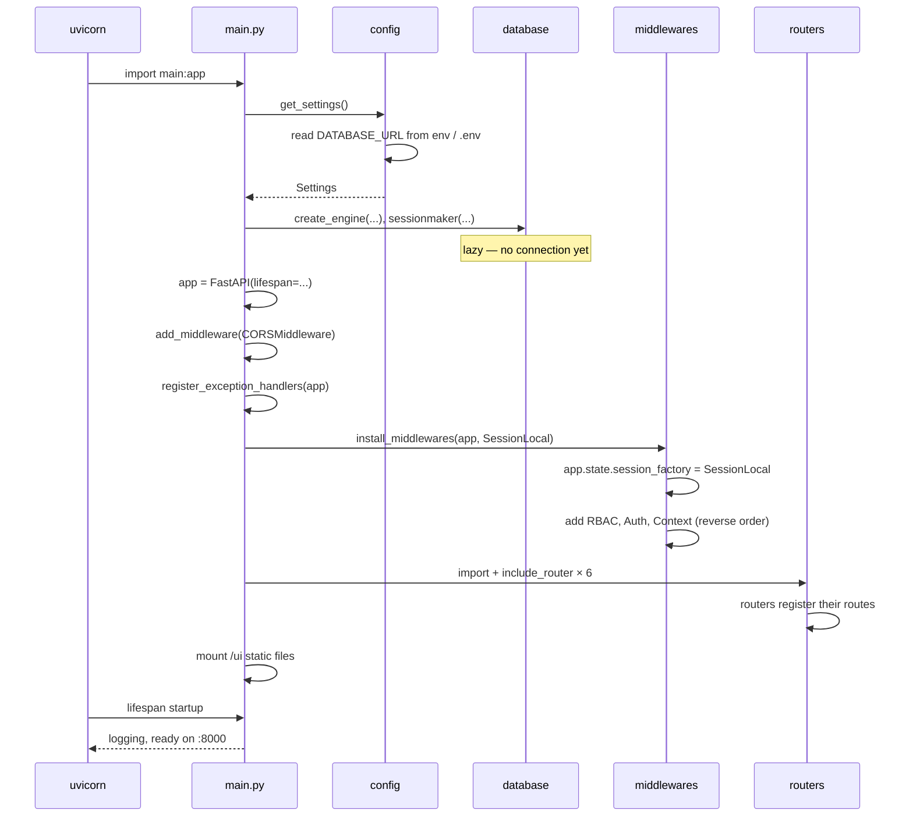
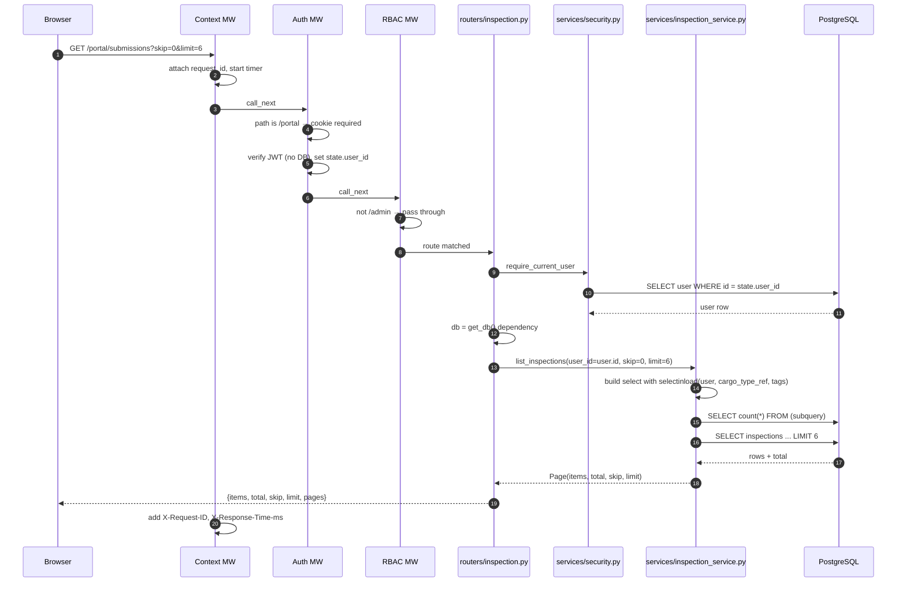
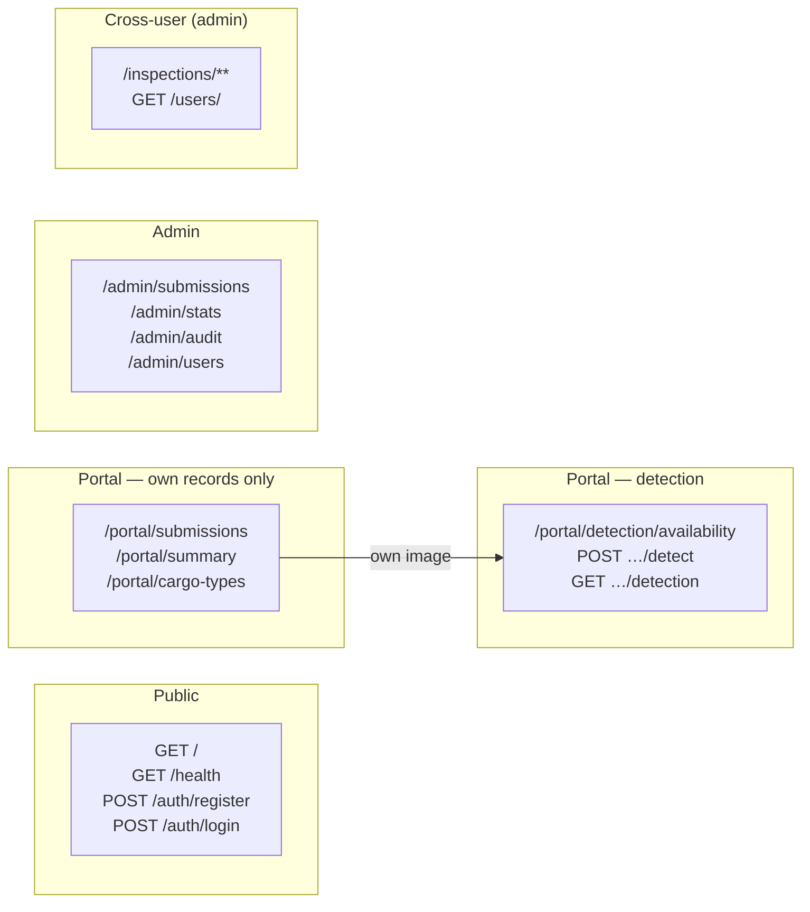
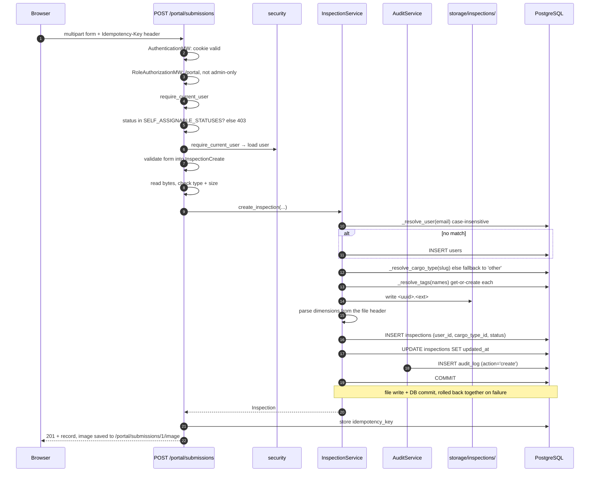
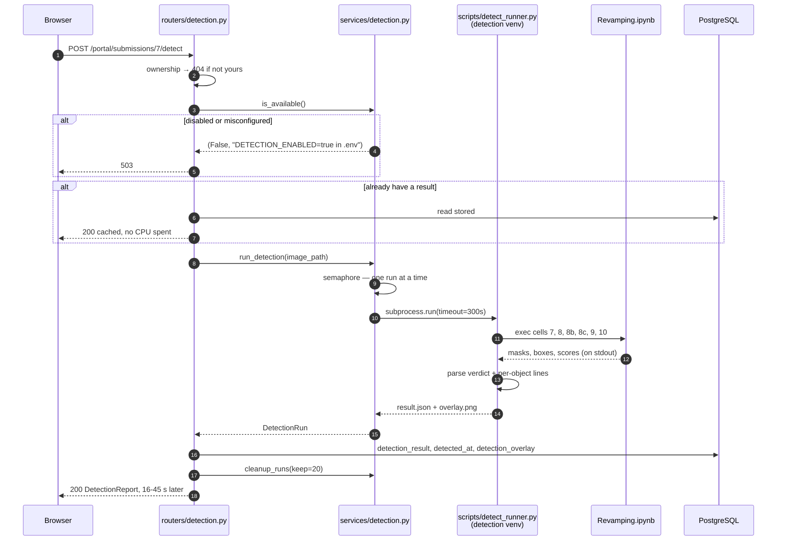
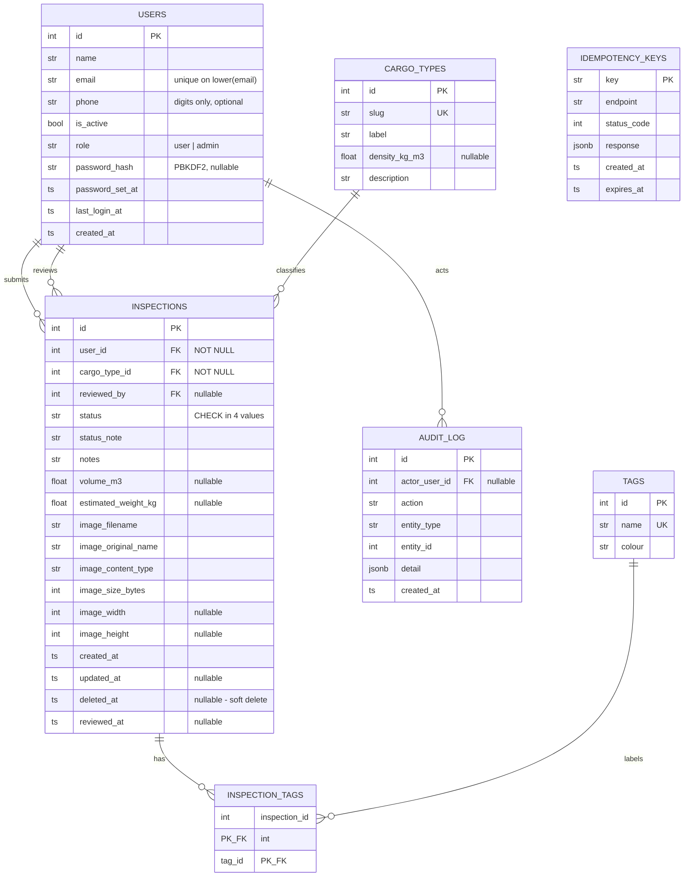

# Flow.md — How This API Actually Works

A working tour of `awesome-project`: what each layer does, what happens on every
request, and where the security decisions live. Written against the code as it
stands at schema revision `0010_roles_and_reviews`.

---

## Contents

1. [What this system does](#1-what-this-system-does)
2. [Project layout](#2-project-layout)
3. [The four layers](#3-the-four-layers)
4. [Startup sequence](#4-startup-sequence)
5. [The middleware stack](#5-the-middleware-stack)
6. [Request lifecycle](#6-request-lifecycle)
7. [Authentication](#7-authentication)
8. [Authorisation (RBAC)](#8-authorisation-rbac)
9. [The four API surfaces](#9-the-four-api-surfaces)
10. [The upload flow, end to end](#10-the-upload-flow-end-to-end)
11. [The detection flow](#11-the-detection-flow)
12. [The admin review flow](#12-the-admin-review-flow)
13. [Database schema](#13-database-schema)
14. [Query patterns](#14-query-patterns)
15. [Error handling](#15-error-handling)
16. [The frontend](#16-the-frontend)
17. [Migration history](#17-migration-history)
18. [Operational runbook](#18-operational-runbook)
19. [Where to read next](#19-where-to-read-next)

---

## 1. What this system does

Two user-facing surfaces over one PostgreSQL database:

**Portal (self-service)** — a signed-in person fills in details, uploads a cargo
image, and sees their own submissions as a paginated card list. They can search,
filter by cargo type, and withdraw their own work.

**Admin** — sees every submission from every user, works through a review queue,
and approves or rejects each one, individually or in bulk. Also reads the audit
log, platform statistics, and manages roles.

The image **bytes never go into the database**. The file is written to
`storage/inspections/`; PostgreSQL holds only the filename and its metadata.

---

## 2. Project layout

```text
awesome-project/
├── main.py                  # composition root: app, middleware, routers, static
├── config.py                # Settings — single source of DATABASE_URL
├── database.py              # engine, session factory, Base, get_db
├── errors.py                # global exception handlers
│
├── middlewares/             # cross-cutting request pipeline
│   ├── __init__.py          #   install_middlewares() + ordering
│   ├── context.py           #   request id, timing, logging
│   ├── auth.py              #   401 gate on /portal, /admin
│   └── rbac.py              #   403 gate on /admin
│
├── models/                  # SQLAlchemy tables
│   ├── __init__.py          #   imports everything (Alembic depends on this)
│   ├── user.py              #   users
│   ├── inspection.py        #   inspections
│   ├── cargo_type.py        #   cargo_types (lookup)
│   ├── tag.py               #   tags
│   ├── inspection_tag.py    #   inspection_tags (join table)
│   ├── audit_log.py         #   audit_log
│   └── idempotency_key.py   #   idempotency_keys
│
├── schemas/
│   ├── requests/            # inbound validation
│   ├── responses/           # outbound serialisation
│   ├── validators.py        #   phone normalisation
│   └── errors.py            #   JSON-safe validation errors
│
├── services/                # business logic
│   ├── inspection_service.py
│   ├── user_service.py
│   ├── auth_service.py
│   ├── audit_service.py
│   ├── idempotency_service.py
│   ├── health_service.py
│   ├── query.py             #   pagination envelope
│   ├── security.py          #   password hashing, JWT, get_current_user
│   ├── rbac.py              #   roles and permissions
│   └── detection.py         #   subprocess bridge to the SAM/YOLO pipeline
│
├── routers/                 # HTTP endpoints
│   ├── auth.py  user.py  health.py
│   ├── inspection.py        #   cross-user router + portal router
│   ├── detection.py         #   portal detection router
│   └── admin.py             #   admin router
│
├── static/index.html        # the whole frontend
├── alembic/versions/        # 0001 … 0011
├── scripts/                 # setup_postgres, start_postgres, create_admin,
│                            #   detect_runner (runs the notebook cells)
└── tests/                   # 221 tests
```

### The one component outside this tree

The cargo detector is a **31-cell Jupyter notebook** in a separate project, run
by a separate ~5.5 GB virtualenv (torch, ultralytics, segment-anything,
transformers, Open3D). Those cannot be merged into this app's environment, so
`services/detection.py` invokes `scripts/detect_runner.py` as a subprocess and
the two sides meet at a JSON file. See `DETECTION.md`.

---

## 3. The four layers

Requests flow downward. Each layer may only talk to the one below it.

```text
routers/     HTTP. Parses request, resolves dependencies, shapes the response.
             Knows nothing about SQL.
    ↓
services/    Business rules and database access. Knows nothing about HTTP —
             it receives a Session and plain Python values.
    ↓
models/      Table definitions and relationships. Knows nothing about either.
    ↓
database.py  Engine, session factory, and the get_db dependency.
```

**Why this matters:** swapping PostgreSQL for something else touches
`database.py` and the driver, and nothing else. Adding a field touches the model,
a schema, and a migration — never a router's SQL.

Two supporting layers sit beside them:

- `middlewares/` — cross-cutting concerns applied to every request before any
  router sees it.
- `schemas/` — the validation boundary. `requests/` for inbound, `responses/` for
  outbound, and `responses/` doubles as the OpenAPI documentation.

---

## 4. Startup sequence



Two orderings are load-bearing:

**Middleware** — Starlette makes the *last added* the *outermost*. `install_middlewares`
adds RBAC, then Auth, then Context, so Context wraps everything and Auth wraps RBAC.
The RBAC layer reads the user id that Auth attached to `request.state`.

**Routers** — `health` is registered last so `/health` keeps its literal path and
cannot be shadowed by a `/{id}` pattern on a resource router.

### Database connections are lazy

`create_engine` does not connect. The first actual connection happens on the first
query. That is why `main.py` imports cleanly even if PostgreSQL is stopped — and
why the failure appears on the first request instead:

```text
(psycopg.OperationalError) connection to server at "127.0.0.1", port 5432
failed: Connection refused
```

`?connect_timeout=10` in `DATABASE_URL` stops that from hanging for two minutes.

---

## 5. The middleware stack

```mermaid
flowchart TD
    A[HTTP request] --> B["RequestContextMiddleware<br/>tag with X-Request-ID, start timer"]
    B --> C["AuthenticationMiddleware<br/>401 if path is /portal or /admin<br/>and no valid session cookie"]
    C --> D["RoleAuthorizationMiddleware<br/>403 if path is /admin<br/>and role != admin"]
    D --> E[CORS middleware<br/>answers preflight OPTIONS"]
    E --> F{Route matched?}
    F -->|no| G[404]
    F -->|yes| H[dependencies resolve<br/>get_db + require_permission]
    H --> I[handler runs]
    I --> J[Exception handlers<br/>IntegrityError → 409<br/>SQLAlchemyError → 503<br/>anything else → 500 + request_id]
    J --> B
    B --> K["X-Request-ID + X-Response-Time-ms<br/>added to the response"]
```

### `context.py` — correlation

Every request gets an id, taken from the incoming `X-Request-ID` header if the
client supplied one, otherwise generated. It is written to every log line and
returned in the response header. When an unhandled exception occurs, that same id
is returned in the body — so a client can quote it in a bug report instead of
receiving a stack trace.

### `auth.py` — the 401 gate

```python
PROTECTED_PREFIXES = ("/portal", "/admin")
```

Requests under those prefixes must carry a valid session cookie. The cookie is
verified *without touching the database* — JWT signature and expiry only — and
the claims are stashed on `request.state`.

This layer cannot tell whether `/inspections/7` belongs to you. It only knows
whether anyone is signed in.

### `rbac.py` — the 403 gate

For `/admin` paths it reads the role **from the database**, not from the token. A
demotion therefore takes effect on the next request instead of waiting for the
token to expire. The token deliberately carries no role claim.

The session factory is read from `app.state.session_factory` at request time
rather than captured at construction — one place owns the factory, and tests can
point it at their rolled-back transaction.

### Why two layers

| | Middleware | Dependency |
|---|---|---|
| Can gate a whole prefix | yes | no |
| Can check ownership | **no** | yes |
| Runs before routing | yes | no |
| Cost | cheap, no DB (auth) | one query |

Neither replaces the other. The middleware stops a request that should never have
been routed; the dependency answers "is this record *yours*?".

---

## 6. Request lifecycle

A portal read of your own submissions:



---

## 7. Authentication

### Passwords

```text
pbkdf2_sha256$260000$<salt base64>$<hash base64>
```

- PBKDF2-HMAC-SHA256, 260,000 iterations, stdlib only.
- Random 16-byte salt per password — identical passwords produce different digests.
- Algorithm and iteration count are stored in the digest, so the work factor can
  be raised later without invalidating existing passwords.
- Verified with `hmac.compare_digest`, which does not leak the match position
  through timing.

`password_problems()` rejects short passwords, all-letter or all-digit passwords,
and a list of predictable ones (`password1`, `qwerty12`, `admin123`, …) that would
otherwise pass a naive length check.

### Sessions

| Property | Value | Why |
|---|---|---|
| Transport | JWT in an httpOnly cookie | JavaScript cannot read it, so an XSS bug cannot steal the session |
| `SameSite` | `strict` | not sent on cross-site requests |
| `Secure` | off in dev, on via `COOKIE_SECURE` | HTTPS-only in production |
| Lifetime | 12 hours | |

The token is **never** in a response body — only in the `Set-Cookie` header. A
test asserts this.

### Two credentials, one session

The same JWT is accepted two ways:

| Credential | Used by | Why |
|---|---|---|
| httpOnly cookie | the portal at `/ui/` | JavaScript cannot read it, so XSS cannot steal it |
| `Authorization: Bearer <jwt>` | Swagger UI, curl, scripts | Swagger's Authorize dialog **cannot hold a cookie** |

```python
raw = token                                   # the cookie, checked first
if not raw and credentials and credentials.scheme.lower() == "bearer":
    raw = credentials.credentials
```

Both layers must accept it. `middlewares/auth.py` runs *before routing*, so a
valid bearer token rejected there would never reach the dependency that would
have accepted it — `services/detection.py` and the portal router share the same
`extract_token()` helper for exactly this reason.

Without the `HTTPBearer` scheme declared, `/docs` renders **no Authorize button
at all** — its dialog only understands apiKey, bearer and OAuth2.
`tests/test_docs_auth.py` pins all three halves: the scheme exists, protected
operations declare it, and the token actually authenticates.

### Enumeration defence

`authenticate()` returns the identical message for an unknown email and a wrong
password:

```text
Email or password is incorrect.
```

It also hashes a dummy value when the account does not exist, so a missing
account and a wrong password take comparable time.

### Routes

```text
POST /auth/register     create an account, sign in immediately
POST /auth/login        exchange credentials for a cookie
POST /auth/logout       clear the cookie
GET  /auth/me           bootstrap: the user + their permission list
POST /auth/set-password first password for an account that has none
POST /auth/change-password
```

`/auth/me` returning 401 on page load is how the frontend decides to show the
sign-in screen rather than the dashboard.

---

## 8. Authorisation (RBAC)

### Roles → permissions → routes

```text
users.role  ('user' | 'admin')     CHECK constraint enforces the pair
      ↓
ROLE_PERMISSIONS                  services/rbac.py
      ↓
require_permission(P_...)         dependency on each route
```

### The catalogue

| Permission | user | admin |
|---|:--:|:--:|
| `submissions:create` | ✅ | ✅ |
| `submissions:read:own` | ✅ | ✅ |
| `submissions:update:own` | ✅ | ✅ |
| `submissions:withdraw:own` | ✅ | ✅ |
| `users:read:own` | ✅ | ✅ |
| `submissions:read:any` | ❌ | ✅ |
| `submissions:review:any` | ❌ | ✅ |
| `submissions:delete:any` | ❌ | ✅ |
| `submissions:restore:any` | ❌ | ✅ |
| `users:read:any` | ❌ | ✅ |
| `users:manage` | ❌ | ✅ |
| `audit:read` | ❌ | ✅ |

`own` and `any` are separate permissions, and that split is what stops a user
editing somebody else's submission by changing an id in the URL.

### Failing closed

An unrecognised role stored in the database degrades to `user`:

```python
try:
    return Role(value)
except ValueError:
    return Role.USER
```

A corrupt value grants nothing.

### Status transitions

```text
draft ──▶ submitted ──▶ approved
                  └──▶ rejected
```

A user may set only `draft` or `submitted`. `SELF_ASSIGNABLE_STATUSES` exists so
that nobody approves their own work by choosing a status in the upload form — the
portal route returns **403** with "Approval is done by an administrator".

### 404 vs 403

Both appear, and the distinction is deliberate:

| Situation | Code | Reason |
|---|---|---|
| No session | **401** | "who are you?" |
| Signed in, wrong role | **403** | "you exist, but not for this" |
| Signed in, another user's record | **404** | a 403 would confirm the id exists |

The last row is the one worth remembering: returning 403 for
`/portal/submissions/999` would let an attacker enumerate which submissions exist.

### The hole this closed

Before RBAC, with **no cookie at all**:

```text
PATCH /inspections/1  {"status":"approved"}  -> 200 approved
DELETE /inspections/1/purge                    -> 204
GET  /users/                                   -> 200, every email exposed
```

Those routes now carry a router-level dependency, so a new endpoint added there
is protected by default rather than by remembering to add a check.
`tests/test_rbac.py::TestPreviouslyOpenRoutes` pins all of it.

---

## 9. The four API surfaces



| Surface | Prefix | Guard |
|---|---|---|
| Public | `/`, `/health`, `/auth/*` | none or "signed in" |
| Portal | `/portal/**` | session + ownership per record |
| Detection | `/portal/detection/*`, `/portal/…/detect` | session + `submissions:create` + ownership |
| Admin | `/admin/**` | session + `role == admin` (middleware **and** dependency) |
| Cross-user | `/inspections/**`, `GET /users/` | `require_permission(read_any)` |

Two admin surfaces exist because they serve different jobs: `/admin/**` is the
review workflow, `/inspections/**` is the lower-level cross-user API.

Detection sits inside the portal rather than beside it because it acts on the
caller's **own** submission — same ownership rule, same 404-on-someone-else's-id.
Admins get a read-only view (`/admin/submissions/{id}/detection`) and cannot
trigger a run: working a review queue must not cost 30 s of CPU per row.

---

## 10. The upload flow, end to end

What happens when the signed-in user uploads through the portal.



### Three details worth understanding

**Find-or-create, not create.** The same person typing `Asha@x.com` and
`asha@X.com` must not become two users. Lookup is `lower(email)`, and the
database has a unique index on `lower(email)` underneath — the service check
handles the normal case, the index handles the race.

**The file and the row commit together.** The file is written first; if the
transaction fails it is deleted in the `except` block. An orphaned image is
avoidable garbage, an orphaned row is a broken record.

**Dimensions come from parsing the header.** `_image_dimensions()` reads PNG,
GIF, WebP and JPEG headers directly with `struct` and `int.from_bytes` — no Pillow
in this environment. It returns `None` for anything it cannot read, and the
columns are simply null.

**Idempotency.** A retry after a network timeout carries the same
`Idempotency-Key`, and the stored response is returned instead of creating a
second row.

---

## 11. The detection flow

The one request in this app that leaves the process. Full detail in
`DETECTION.md`; the shape of it:



### Four decisions worth understanding

**A refusal is a success.** An image with no cargo returns **200** with
`detected: false`. "Nothing there" is a correct answer; making the caller read a
503 as "no cargo" would be a lie in the other direction. A *broken* detector
returns 502, so the three outcomes never blur.

**The measurement stage is not run.** Notebook cells 12–28 compute depth, point
cloud and volume. They are excluded, so `volume_m3` and `estimated_weight_kg`
stay `null` — their output is *relative* volume from normalised camera
intrinsics, and storing a dimensionless number in a column named `volume_m3`
would look authoritative forever after.

**The result is the detector's, stored verbatim.** It goes into one JSONB
column rather than a family of columns, so a pipeline change needs no
migration. `status` (`not_run` / `detected` / `no_cargo` / `error`) is *derived*
from it, never stored, so it cannot drift.

**One run at a time.** The notebook's cells share module state and write into
one project directory; overlapping runs would corrupt each other. The second
caller gets **503**, not a corrupted first result.

---

## 12. The admin review flow

```mermaid
flowchart TD
    A[Admin opens Admin tab] --> B[GET /admin/stats]
    B --> C[GET /admin/submissions<br/>filters: search, status, cargo]
    C --> D[Review queue<br/>status = submitted]
    D --> E{Decide}
    E -->|approve one| F["POST /admin/submissions/&#123;id&#125;/approve?note=..."]
    E -->|reject one| G["POST /admin/submissions/&#123;id&#125;/reject?note=..."]
    E -->|bulk| H["POST /admin/submissions/bulk<br/>ids + action"]
    F --> I[set status, status_note,<br/>reviewed_by, reviewed_at]
    G --> I
    H --> I
    I --> J[audit_log entry<br/>action = approved/rejected]
    J --> K[list refreshes,<br/>pending count drops]
```



- A duplicate decision returns **409** — it is not silently idempotent, so a
  double-click is reported rather than hidden.
- Bulk processing is **per-item**: one bad id does not abort the batch, and the
  response says what happened to each.
- Every decision records `reviewed_by` and `reviewed_at` **on the row**, plus an
  audit entry with the acting admin. The row can answer "who decided this"
  without a join into the log.

### The review-queue index

```sql
CREATE INDEX ix_inspections_pending_review ON inspections (created_at)
    WHERE status = 'submitted' AND deleted_at IS NULL;
```

A partial index: only rows actually in the queue are indexed, so the index stays
small however many decided rows accumulate.

---

## 13. Database schema



### Design decisions

| Decision | Reason |
|---|---|
| No `name`/`email` on `inspections` | `users` is the single source of truth; duplicated columns drift |
| `cargo_type_id` FK, not free text | `'Scrap Steel'`, `'scrap steel'` and `'SCRAP STEEL'` were three values; a lookup gives one row with a density |
| `deleted_at` soft delete | a hard delete cascades and destroys the history; `restore` exists |
| `inspection_tags` join table | the canonical many-to-many; carries no data beyond the two keys |
| `audit_log.detail` JSONB | variable context without a second table |
| `image_filename` is a UUID | two uploads named `photo.jpg` must not collide |
| `reviewed_by` nullable | only an admin ever sets it |

**`volume_m3` and `estimated_weight_kg` are already in the schema and currently
null.** They exist for the cargo-detection pipeline: measure the mask, look up
`cargo_types.density_kg_m3`, and write `volume × density`. Nothing populates them
yet.

### Indexes that earn their keep

```text
uq_users_email_lower            unique on lower(email)   — closes the case race
ix_inspections_created_at_live  WHERE deleted_at IS NULL
ix_inspections_pending_review   WHERE status='submitted' AND deleted_at IS NULL
ix_users_password_hash          WHERE password_hash IS NOT NULL
```

---

## 14. Query patterns

`tests/test_query_patterns.py` is the place to learn these — each test names the
pattern it exercises.

### Eager loading (avoiding N+1)

```python
select(Inspection).options(
    selectinload(Inspection.user),
    selectinload(Inspection.cargo_type_ref),
    selectinload(Inspection.tags),
)
```

Without this, serialising `inspection.user.name` issues one extra `SELECT` per
row. Measured before the fix: 101 queries for 100 inspections. After: 2. A test
asserts the count stays flat as rows increase.

`Inspection.user` needs `foreign_keys=[user_id]` because `inspections` references
`users` **twice** — the submitter and the reviewer — and SQLAlchemy cannot infer
which one a relationship means.

### Pagination envelope

```python
count_stmt = select(func.count()).select_from(stmt.order_by(None).subquery())
rows = db.execute(stmt.offset(skip).limit(limit)).scalars().unique().all()
```

Two queries: the count for page controls, the page itself. `skip` and `limit` are
clamped in `services/query.py` **and** constrained in the router with
`Query(ge=0)` / `Query(ge=1, le=100)`.

Before those bounds existed, `?limit=-5` reached PostgreSQL and returned a raw
**500**. Two independent layers now stop it.

### Aggregates in the database

```python
select(
    User.id.label("user_id"),
    func.count(Inspection.id).label("inspection_count"),
    func.coalesce(func.sum(Inspection.estimated_weight_kg), 0.0),
)
.select_from(User)
.outerjoin(Inspection, and_(Inspection.user_id == User.id,
                            Inspection.deleted_at.is_(None)))
.group_by(User.id, User.name, User.email)
```

`outerjoin`, not `innerjoin` — a user with zero inspections must still appear.
`stats(user_id=...)` puts the filter in the `WHERE` clause rather than filtering
in Python, so the portal's per-user counts stay one round trip.

### Correlated NOT EXISTS

```python
has_inspection = select(Inspection.id).where(
    Inspection.user_id == User.id, Inspection.deleted_at.is_(None))
users_without_inspections = select(User).where(~has_inspection.exists())
```

"Users who have never submitted" without loading every inspection.

### Whitelisted sorting

`sort` is compared against an allowed set and the ORM attribute is chosen from a
dictionary — never interpolated into SQL. `?sort=id;DROP TABLE users` returns 422.

---

## 15. Error handling

| Situation | Status | Body |
|---|---|---|
| Validation failed | 422 | `[{loc, msg, input}]`, guaranteed JSON-safe |
| Not signed in | 401 | `{detail, code: authentication_required}` |
| Wrong role | 403 | `{detail, code: insufficient_role, your_role}` |
| Another user's record | 404 | `{detail}` |
| Duplicate email | 409 | `{detail, code: duplicate_email}` |
| Duplicate review decision | 409 | `{detail}` |
| Anything unexpected | 500 | `{detail, request_id}` |

### Two lessons encoded here

**`exc.errors()` is not always serialisable.** It carries the raw exception under
`ctx`, so passing it to `HTTPException(detail=...)` made Starlette's `json.dumps`
fail with `TypeError: Object of type ValueError is not JSON serializable` — a
client error became a **500**. `schemas/errors.py::jsonable_errors()` strips the
unserialisable parts.

**Constraint violations are client errors.** An `IntegrityError` returning 500
misleads whoever is debugging it and leaks schema detail. The handler maps it to
409 with a specific message.

---

## 16. The frontend

`static/index.html` is one self-contained file — no framework, no build step.
Served by `StaticFiles` at `/ui/`.

### Boot

```text
GET /auth/me
  401 → sign-in screen
  200 → dashboard, and show the Admin tab only if is_admin
```

The tab is hidden rather than merely failing if clicked, because `/auth/me`
returns the permission list specifically so the UI can render only what will work.

### Structure

```text
authView    sign in / register
portalView
├── My submissions   stat tiles · search · cargo filter · card grid · pagination
├── Upload           cargo type · status · tags · notes · drop zone
└── Admin            review queue · per-card approve/reject · bulk select · filters
```

### Empty state

With no submissions the list renders an explicit call to action rather than a
blank grid:

```text
No submissions yet
Upload your first cargo image and it will appear here with its status,
cargo type and dimensions.
                                    [ Upload your first image ]
```

which switches to the upload tab.

### Notable details

- Portal cards load images from `/portal/submissions/{id}/image` (owner-scoped).
  The plain `/inspections/{id}/image` route is admin-only — an early version of
  RBAC broke every thumbnail, and tests now pin both halves.
- Uploads send an `Idempotency-Key`, so a retry after a timeout does not duplicate.
- Cargo types are fetched from `/portal/cargo-types`, not hardcoded in the HTML.
- `escapeHtml()` on every interpolated value.

---

## 17. Migration history

| # | Revision | What it did |
|---|---|---|
| 0001 | `0001_initial` | `users`, `addresses` |
| 0002 | `0002_create_inspections` | `inspections` |
| 0003 | `0003_link_inspections_to_users` | linked inspections to users; backfilled by email; dropped duplicated columns |
| 0004 | `0004_add_phone_drop_addresses` | added `users.phone`; dropped the empty `addresses` table |
| 0005 | `0005_email_lower_unique` | unique index on `lower(email)` |
| 0006 | `0006_status_soft_delete` | `status`, `updated_at`, `deleted_at` |
| 0007 | `0007_cargo_types_lookup` | `cargo_types` table + density; replaced free text |
| 0008 | `0008_tags_audit_and_idempotency` | `tags`, `inspection_tags`, `audit_log`, `idempotency_keys` |
| 0009 | `0009_user_credentials` | `password_hash`, `last_login_at`, `is_admin` |
| 0010 | `0010_roles_and_reviews` | `role` replaced `is_admin`; `reviewed_by`, `reviewed_at` |

Every one round-trips upgrade → downgrade → upgrade, and was tested on a throwaway
database before touching the real one.

**One gotcha worth remembering:** `alembic_version.version_num` is `VARCHAR(32)`.
Two revision ids I first wrote were 34 and 38 characters and the migration
crashed with `value too long for type character varying(32)`.

Current state:

```console
alembic current  -> 0010_roles_and_reviews (head)
alembic check    -> No new upgrade operations detected.
```

---

## 18. Operational runbook

```powershell
cd C:\Users\Abhijeet\Desktop\FastAPI\awesome-project

# 1. PostgreSQL
powershell -ExecutionPolicy Bypass -File scripts\start_postgres.ps1

# 2. dependencies
uv sync

# 3. configuration
Copy-Item .env.example .env

# 4. create the database + apply migrations (first run)
.venv\Scripts\python.exe scripts\setup_postgres.py

# 5. run
.venv\Scripts\python.exe -m uvicorn main:app --reload
```

Then <http://127.0.0.1:8000/ui/>.

### Day-to-day

```powershell
.venv\Scripts\python.exe scripts\start_postgres.ps1        # ensure it is up
.venv\Scripts\python.exe -m pytest tests/ -q               # 150 tests
.venv\Scripts\python.exe -m alembic check                  # no schema drift
```

### The first administrator

RBAC has a bootstrap problem: promoting a user needs an admin, but nobody is one
yet.

```powershell
# create a new admin
.venv\Scripts\python.exe scripts\create_admin.py `
    --email you@example.com --name "Your Name" --password "your-password"

# promote someone who already registered
.venv\Scripts\python.exe scripts\create_admin.py --email them@example.com

# see everyone and their role
.venv\Scripts\python.exe scripts\create_admin.py --list
```

### Before this goes anywhere real

```ini
JWT_SECRET=<openssl rand -hex 32>   # currently random per process
COOKIE_SECURE=true                   # once on HTTPS
CORS_ORIGINS=["https://your-domain"]
```

A generated `JWT_SECRET` means every restart invalidates existing sessions.

### Starting over

```powershell
.venv\Scripts\python.exe scripts\setup_postgres.py --reset --password postgres
```

Drops the database, recreates it, replays all migrations. **Deletes everything.**

---

## 19. Where to read next

| If you want to… | Read |
|---|---|
| Learn the SQL patterns | `tests/test_query_patterns.py` — each test names its pattern |
| Understand a bug that was fixed | `tests/test_bug_regressions.py` — one test per measured defect |
| See the security properties | `tests/test_rbac.py` — isolation, self-approval, 404-vs-403 |
| Learn password/JWT handling | `services/security.py` |
| Learn roles and permissions | `services/rbac.py` |
| Understand request pipeline | `middlewares/` — each file is short and commented |
| Trace a request | `routers/inspection.py` → `services/inspection_service.py` |
| Learn migrations | `Alembic.md` — full deep dive, autogenerate internals, batch mode |
| Set up PostgreSQL | `POSTGRES.md` and `POSTGRES_COMMANDS.md` |

### Known gaps

1. `volume_m3` and `estimated_weight_kg` are never populated — they are waiting
   for the detection pipeline.
2. Images live on local disk, so a second app instance cannot serve them. Moving
   to S3 or MinIO changes only `resolve_image_path()` and `create_inspection()`.
3. No rate limiting on `/auth/login`, so the login endpoint is brute-forceable.
4. No refresh-token rotation; the session simply expires after 12 hours.
5. Tests roll back a transaction rather than truncating, so a service that calls
   `db.commit()` inside a test would escape the rollback. Nothing does today.