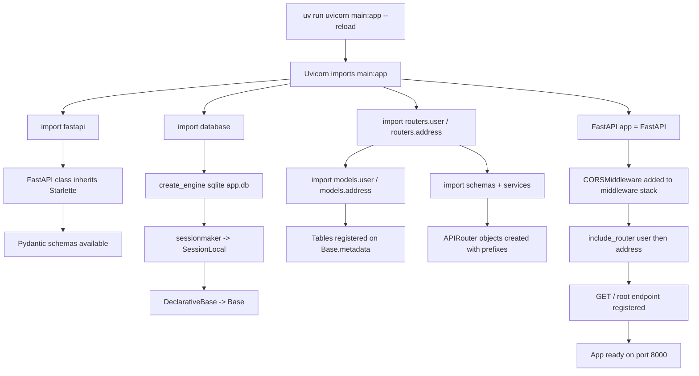
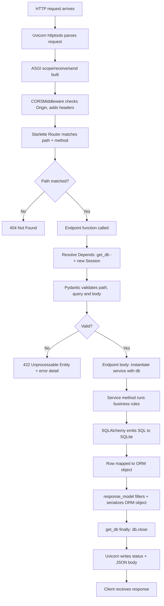
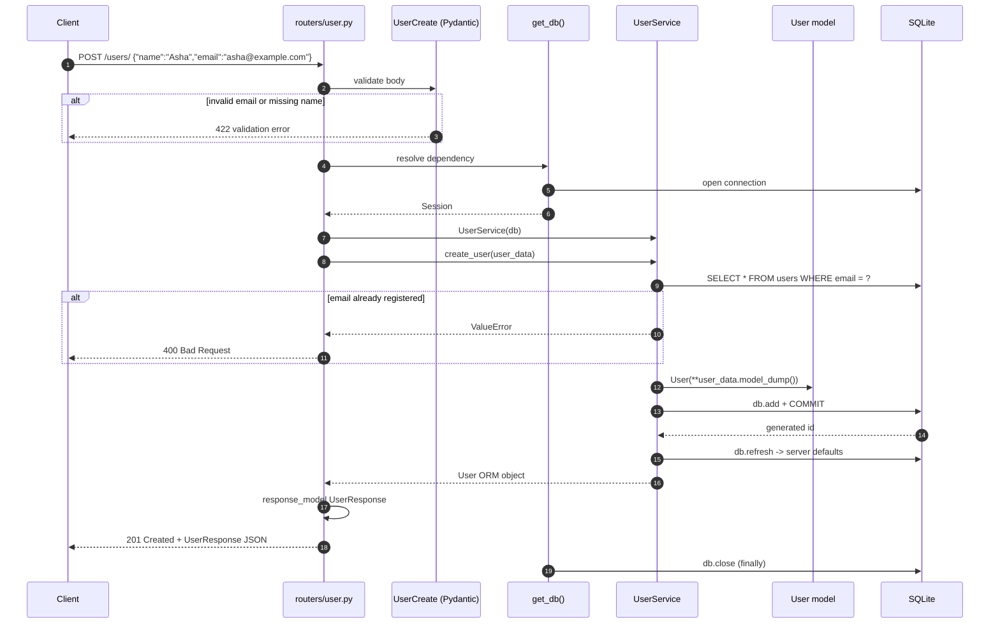
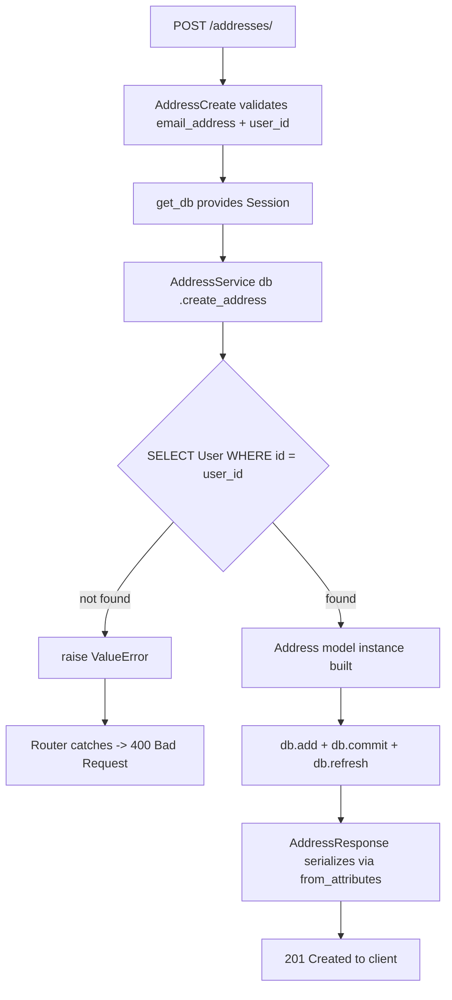
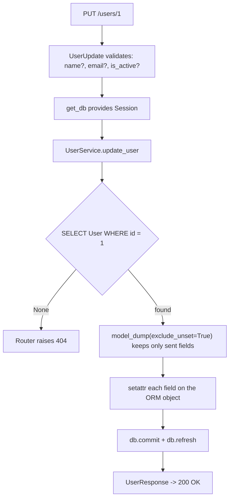
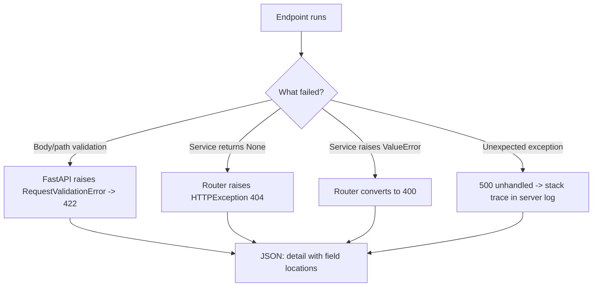
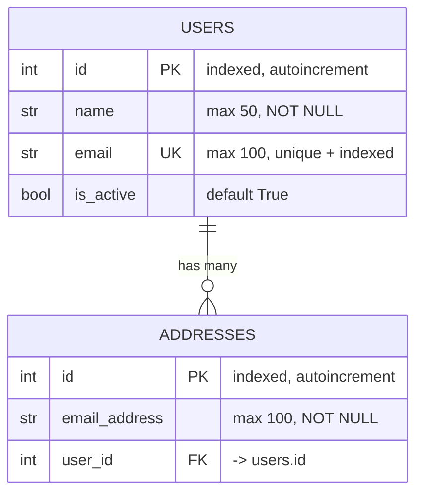
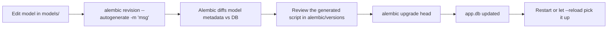

# User-Address API (FastAPI)

A layered REST API for managing users and their addresses, built with FastAPI,
SQLAlchemy, Pydantic, Alembic, and SQLite.

The project follows a strict four-layer split so that HTTP concerns, validation,
business rules, and database access stay separable:

```text
HTTP Layer        -> routers/
Validation Layer  -> schemas/
Business Layer    -> services/
Data Layer        -> models/ + database.py
Database          -> SQLite (app.db)
```

---

## Table of contents

1. [Project layout](#project-layout)
2. [Technology stack](#technology-stack)
3. [How the layers fit together](#how-the-layers-fit-together)
4. [Flow charts](#flow-charts)
   - [Startup flow](#startup-flow)
   - Request lifecycle](#request-lifecycle)
   - `POST /users/` sequence](#post-users-sequence)
   - `POST /addresses/` with ownership check](#post-addresses-with-ownership-check)
   - `PUT` partial update flow](#put-partial-update-flow)
   - Error handling flow](#error-handling-flow)
5. [Data model](#data-model)
6. [API reference](#api-reference)
7. [Migrations (Alembic)](#migrations-alembic)
8. [Running the project](#running-the-project)
9. [Dependency notes](#dependency-notes)
10. [Roadmap / next steps](#roadmap--next-steps)

---

## Project layout

```text
awesome-project/
├── main.py                 # FastAPI app, CORS, router registration, root route
├── database.py             # Engine, session factory, Base, get_db dependency
├── pyproject.toml          # uv project definition (source of truth)
├── requirements.txt        # legacy pip pins (see Dependency notes)
├── uv.lock                 # resolved dependency graph
├── alembic.ini             # Alembic config, DB URL
├── app.db                  # SQLite database file
├── alembic/
│   ├── env.py              # Autogenerate target metadata from Base + models
│   └── versions/
│       └── 0001_initial.py # users + addresses tables
├── models/                 # SQLAlchemy ORM tables
│   ├── user.py
│   └── address.py
├── schemas/
│   ├── requests/           # Pydantic inbound models
│   │   ├── user.py         # UserCreate, UserUpdate
│   │   └── address.py      # AddressCreate
│   └── responses/          # Pydantic outbound models
│       ├── user.py         # UserResponse
│       └── address.py      # AddressResponse
├── services/               # Business logic and DB operations
│   ├── user_service.py
│   └── address_service.py
└── routers/                # HTTP endpoints
    ├── user.py
    └── address.py
```

Related docs in this repo:

- `ARCHITECTURE_FLOW.md` — layer-by-layer reference and Mermaid diagrams.
- `working_deps_libs.md` — full pinned dependency inventory.
- `Initial_Notes.txt` — raw notes on FastAPI, Pydantic, Starlette, Uvicorn.

---

## Technology stack

| Layer | Technology | Version (uv.lock) | Role in this project |
|---|---|---:|---|
| Web framework | **FastAPI** | 0.142.2 | App object, `APIRouter`, `Depends`, `HTTPException`, `response_model`, auto OpenAPI docs |
| ASGI foundation | **Starlette** | 1.7.0 | Routing, middleware pipeline, CORS, lifespan events. `FastAPI` subclasses `Starlette`, so every Starlette feature is available |
| Server | **Uvicorn** | 0.54.0 | ASGI server that actually accepts sockets and calls the app. Not a framework — it does no path routing |
| HTTP parser | **httptools** | 0.8.0 | High-speed HTTP/1.1 parsing used by Uvicorn (via `uvicorn[standard]`) |
| Event loop | **uvloop** | 0.23.0 | Faster asyncio event loop implementation used by Uvicorn |
| Validation | **Pydantic** | 2.13.5 | Request/response schemas, `model_dump()`, `EmailStr`, `from_attributes` |
| Email validation | **email-validator** | 2.3.0 | Backs `pydantic.EmailStr` |
| ORM | **SQLAlchemy** | 2.1.1 | `DeclarativeBase`, `Mapped`/`mapped_column`, `relationship`, `Session`, query engine |
| Migrations | **Alembic** | 1.20.0 | Versioned schema changes, `upgrade`/`downgrade` |
| Templating for migrations | **Mako** | 1.4.3 | Renders revision scripts from `script.py.mako` |
| Database | **SQLite** | built-in | Single-file `app.db`, local dev only |
| Package/env manager | **uv** | — | Creates `.venv`, resolves `uv.lock`, runs scripts |
| Language | **Python** | 3.12.10 (env), `>=3.12` required | Type hints drive validation and docs |
| ASGI reload (dev) | **watchfiles** | 1.3.0 | File watching for `--reload` |
| API docs UI | **Swagger UI** / ReDoc | bundled | Served at `/docs` and `/redoc` from the generated OpenAPI schema |
| Test client | **httpx** | 0.28.1 | Used by `fastapi.testclient.TestClient` |

### How the pieces relate

```text
Uvicorn (ASGI server)
  └── calls
FastAPI (framework)  ──inherits──>  Starlette (HTTP/routing core)
  ├── Pydantic        (validation, serialization, JSON Schema -> OpenAPI)
  └── SQLAlchemy      (ORM)  ──>  SQLite
Alembic (migrations) ──uses──>   SQLAlchemy + Mako
```

---

## How the layers fit together

### `main.py` — composition root

Creates the app, installs CORS middleware, imports the routers, mounts them, and
serves `GET /`. Nothing else lives here.

```python
app = FastAPI(title="User-Address API", version="1.0.0")
app.add_middleware(CORSMiddleware, allow_origins=["*"], ...)
app.include_router(user_router)
app.include_router(address_router)
```

### `database.py` — data layer foundation

```python
engine = create_engine("sqlite:///./app.db",
                       connect_args={"check_same_thread": False})
SessionLocal = sessionmaker(autocommit=False, autoflush=False, bind=engine)

class Base(DeclarativeBase):
    pass

def get_db():
    db = SessionLocal()
    try:
        yield db
    finally:
        db.close()
```

`get_db` is a generator dependency. FastAPI opens one session per request and
guarantees `db.close()` runs after the response is produced.

### `models/` — table definitions

`User` and `Address` inherit `Base`, so importing them registers their tables on
`Base.metadata` (which is exactly what `alembic/env.py` reads for autogenerate).
`users.id` is the parent of `addresses.user_id`, joined by
`relationship(back_populates=...)` on both sides, with
`cascade="all, delete-orphan"` so deleting a user deletes their addresses.

### `schemas/` — validation boundary

| Schema | Direction | Used by |
|---|---|---|
| `UserCreate` | inbound | `POST /users/` |
| `UserUpdate` | inbound | `PUT /users/{user_id}` (all fields optional) |
| `AddressCreate` | inbound | `POST /addresses/` |
| `UserResponse` | outbound | every `/users/` response |
| `AddressResponse` | outbound | every `/addresses/` response |

`model_config = {"from_attributes": True}` lets Pydantic read straight off SQLAlchemy
ORM instances instead of dicts.

### `services/` — business layer

Plain classes, one per aggregate. The session is injected through the constructor
(`UserService(db)`), so services never import the engine or open connections
themselves. Rules that live here: duplicate-email rejection, referenced-user
existence check, existence-or-`None` returns, and the commit/refresh pairs.

### `routers/` — HTTP layer

Endpoints hold no business logic. They resolve the service, translate `None` into
`404` and `ValueError` into `400`, and declare `response_model` so the response is
validated and documented.

---

## Flow charts

### Startup flow



### Request lifecycle

What happens between a socket accepting bytes and JSON leaving the process:



### `POST /users/` sequence



### `POST /addresses/` with ownership check



### `PUT` partial update flow



Note: `exclude_unset=True` is what makes this a partial update. Fields the client
omits are left untouched rather than reset to `None`.

### Error handling flow



---

## Data model



- One `User` has many `Address` rows; every `Address` belongs to exactly one `User`.
- Deleting a user cascades to their addresses (`cascade="all, delete-orphan"`).
- Both `id` columns are indexed; `users.email` is unique and indexed.

---

## API reference

Base URL `http://127.0.0.1:8000`.

| Method | Path | Body | Success | Notes |
|---|---|---|---|---|
| `GET` | `/` | – | 200 | Health message |
| `GET` | `/users/` | – | 200 | Query: `skip` (0), `limit` (100) |
| `GET` | `/users/{user_id}` | – | 200 | 404 if missing |
| `POST` | `/users/` | `UserCreate` | 201 | 400 if email already registered |
| `PUT` | `/users/{user_id}` | `UserUpdate` | 200 | Partial; 404 if missing |
| `DELETE` | `/users/{user_id}` | – | 204 | Cascades to addresses; 404 if missing |
| `GET` | `/addresses/` | – | 200 | Query: `skip` (0), `limit` (100) |
| `GET` | `/addresses/{address_id}` | – | 200 | 404 if missing |
| `POST` | `/addresses/` | `AddressCreate` | 201 | 400 if `user_id` does not exist |
| `DELETE` | `/addresses/{address_id}` | – | 204 | 404 if missing |

Interactive docs: `/docs` (Swagger UI), `/redoc` (ReDoc), `/openapi.json` (raw schema).

Example payloads:

```jsonc
// POST /users/
{ "name": "Asha", "email": "asha@example.com" }

// PUT /users/1
{ "is_active": false }

// POST /addresses/
{ "email_address": "asha.home@example.com", "user_id": 1 }
```

---

## Migrations (Alembic)

Schema is never created by app startup. It is owned by Alembic.



`alembic/env.py` imports `Base` plus both models and assigns
`target_metadata = Base.metadata`, which is what makes autogenerate aware of every
table. `compare_type=True` catches column type changes as well.

Current revision: `0001_initial` (creates `users` and `addresses`, both indexes, and
the FK constraint). `alembic.ini` points at `sqlite:///./app.db`, matching
`database.py`.

---

## Running the project

Using uv (recommended, matches `pyproject.toml` / `uv.lock`):

```powershell
uv sync
uv run alembic upgrade head      # create/update tables
uv run uvicorn main:app --reload # dev server with auto-reload on :8000
```

Or via the FastAPI standard CLI:

```powershell
uv run fastapi dev
```

Using pip and `requirements.txt`:

```powershell
pip install -r requirements.txt
alembic upgrade head
uvicorn main:app --reload
```

Smoke test:

```powershell
Invoke-RestMethod http://127.0.0.1:8000/
# {"message":"API is running"}
```

> Note: `database.py` creates the engine but never calls `Base.metadata.create_all()`.
> If you skip `alembic upgrade head`, queries will fail with "no such table: users".

---

## Dependency notes

Two dependency descriptions exist and they are **not** aligned:

| Package | `uv.lock` (active) | `requirements.txt` |
|---|---:|---:|
| fastapi | 0.142.2 | 0.115.0 |
| sqlalchemy | 2.1.1 | 2.0.35 |
| pydantic | 2.13.5 | 2.9.0 |
| alembic | 1.20.0 | 1.20.0 |
| uvicorn | 0.54.0 | 0.30.0 |

`pyproject.toml` + `uv.lock` are the source of truth; the `.venv` in this repo was
built from them. `requirements.txt` is a legacy pip path and should be regenerated
from `uv.lock` (for example `uv export`) if pip installs still need to work.

---

## Roadmap / next steps

Ordered roughly by value:

1. Add `get_user_service()` / `get_address_service()` dependencies so routers stop
   constructing services inline.
2. Replace string `ValueError`s with typed custom exceptions and a global handler,
   so routers do not repeat try/except blocks.
3. Validate pagination bounds (`skip >= 0`, `1 <= limit <= 100` via `Query`).
4. Move `SQLALCHEMY_DATABASE_URL` and CORS origins into environment-driven settings
   (`pydantic-settings`), and stop defaulting to `allow_origins=["*"]`.
5. Add tests: service unit tests against SQLite in-memory, plus router tests with
   `TestClient` asserting status codes.
6. Swap SQLite for PostgreSQL (driver change only, plus `alembic` `env.py` review).
7. Add authentication and authorization before exposing mutating routes publicly.